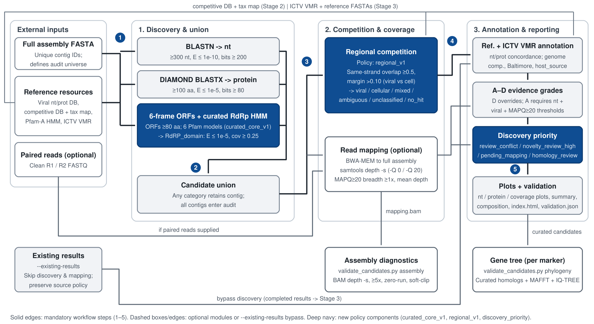

# plant-virus-screen

[中文版](README.zh-CN.md)

An assembly-based workflow for discovering virus-related sequences in plant transcriptomes and producing auditable evidence reports. The current workflow combines a curated RdRp panel, regional competition, separate discovery priority, ICTV VMR annotation and evidence plots, with optional assembly diagnostics and gene-tree analysis.

Policy identifiers: `evidence_policy_version=1.0.0`, `hmm_policy=curated_core_v1`, `competition_method=regional_v1`; report `grading_version=0.3.0-separate-discovery-priority`. These identify separate policies, not a new released package version.

This workflow identifies **candidates**, not confirmed infections or species. It accepts an existing assembly; read cleaning and assembly are upstream tasks. Reads are optional for discovery but required for mapping-supported grade A. Searches are not restricted to plant viruses: sequences from associated organisms may also be detected.

## Workflow overview



*Editable vector sources: [SVG](docs/workflow_figure.svg) · [PDF](docs/workflow_figure.pdf).* The figure summarizes the core workflow stages and optional modules; detailed thresholds and grading rules are described below. See [the standalone diagram notes](docs/workflow.md) for interpretation notes and a text-based Mermaid fallback.

## Contents

- [Requirements and databases](#requirements-and-databases)
- [Quick start](#quick-start)
- [Workflow, step by step](#workflow-step-by-step)
- [Evidence grades](#evidence-grades)
- [Discovery priority](#discovery-priority)
- [Assembly diagnostics and phylogeny](#assembly-diagnostics-and-phylogeny)
- [Options](#options)
- [Output files](#output-files)
- [Reproducibility, validation and limitations](#reproducibility-validation-and-limitations)

## Requirements and databases

### Software

Use a Unix-like shell with Bash and Python 3. Install the Python dependency in your own environment:

```bash
python3 -m pip install -r requirements.txt
```

`requirements.txt` currently specifies `biopython>=1.85`. Fresh discovery requires BLASTN, DIAMOND and HMMER (`hmmsearch`); read mapping also requires BWA and samtools (including `depth -s` support). Optional gene trees require MAFFT and IQ-TREE. Plotting does not require LibreOffice: figures are self-contained HTML with an inline SVG, and PDF exports are generated natively as vector PDF by the shared rendering layer (no external converter).

The discovery engine still defaults to development-machine executable paths. On another machine, explicitly set **absolute executable paths**, for example:

```bash
export PYTHON_BIN=/absolute/path/to/env/bin/python
export BLASTN_BIN=/absolute/path/to/blastn
export DIAMOND_BIN=/absolute/path/to/diamond
export HMMSEARCH_BIN=/absolute/path/to/hmmsearch
export BWA_BIN=/absolute/path/to/bwa
export SAMTOOLS_BIN=/absolute/path/to/samtools
```

Replace these placeholders with installed tools. Bare command names are not sufficient for discovery preflight because executable checks use file paths. `PYTHON_BIN` selects the interpreter used by the shell entry point. Reporting existing results does not invoke the discovery tools.

### Data resources

| Resource | Argument | Purpose |
|---|---|---|
| Assembly FASTA | `--query` | Unique contig IDs; full assembly, not only preselected viral contigs |
| Viral nucleotide BLAST database prefix | `--nt-db` | BLASTN discovery; provide the prefix, not a single index filename |
| Viral protein DIAMOND database | `--viral-db` | Translated similarity discovery |
| Competitive DIAMOND database | `--competitive-db` | Compare candidates against viral and cellular proteins |
| Matching competitive protein FASTA | `--competitive-fasta` | Retrieve subject annotations; plain or gzipped FASTA |
| Subject taxonomy TSV | `--taxonomy-map` | Classify competitive subjects using exact IDs and lineage tokens |
| Pfam-A HMM file | `--pfam` | Extract the six allowlisted viral RdRp models |
| Viral nucleotide FASTA | `--nt-fasta` | Reference labels for reporting; plain FASTA |
| Viral protein FASTA | `--protein-fasta` | Reference labels and protein plots; plain FASTA |
| ICTV VMR workbook | `--vmr` | Reference-derived genome and host annotations |
| Paired-end reads | `--reads1`, `--reads2` | Optional mapping against the full assembly |

Build BLAST and DIAMOND databases with the corresponding tools before running. Keep each database and its source FASTA consistent, including full subject IDs. Large sequence databases, Pfam, reads, assemblies and sample results are not bundled.

### Included ICTV VMR workbook

The repository includes [`data/VMR_MSL41.v1.20260320.xlsx`](data/VMR_MSL41.v1.20260320.xlsx), copied without modification from the user-provided local workbook. Attribution: International Committee on Taxonomy of Viruses (ICTV), Virus Metadata Resource (VMR). This is a pinned local copy, not a claim that the latest release has been retrieved. Its upstream download URL and redistribution terms have not been independently verified here; consult ICTV for current releases and applicable terms. No repository license is asserted over this third-party workbook.

- Required worksheet: `VMR MSL41`
- Parsed data rows: 19,271
- Size: 3,839,416 bytes
- SHA-256: `9d51698034d0bf54648de94b3ff6bf99fc1d9d2b116681991f6284901dd8b4a2`
- Copy provenance: [`data/VMR provenance.json`](data/VMR%20provenance.json)

Always pass `--vmr`; the bundled file is not automatically selected. A replacement workbook must match the sheet/schema expected by `legacy/select_final_candidates.py`.

### Competitive taxonomy format

Use a tab-separated table with unique, nonempty `subject_id` and a `lineage` column. IDs must match the competitive DIAMOND subjects exactly. Example (illustrative IDs):

```tsv
subject_id	lineage
viral_reference_1	Viruses;Riboviria
cellular_reference_1	Eukaryota;Viridiplantae
```

Classification uses exact semicolon-delimited tokens: `Viruses` gives `viral`; `Bacteria`, `Archaea` or `Eukaryota` gives `cellular`; missing, mixed or unsupported lineage assignments remain `unclassified`. Optional columns include taxid, scientific name and mapping provenance. If a sidecar `<map.tsv>.json` exists, the engine checks its FASTA/map hashes and optional database hash. Without a map, competitive hits remain unclassified and cannot satisfy grade A. The historical default auto-map is not distributed (`taxonomy_data/` is ignored); provide your own map explicitly.

## Quick start

Clone the repository and run from its root:

```bash
git clone https://github.com/changQing111/plant-virus-screen.git
cd plant-virus-screen
```

All `/path/to/...` values below are placeholders. Output directories must not already exist. Configure executable paths as described above.

### Full discovery with paired reads

```bash
bash screen_virus_res.sh \
  --query /path/to/assembly.fasta \
  --reads1 /path/to/clean_R1.fastq.gz \
  --reads2 /path/to/clean_R2.fastq.gz \
  --nt-db /path/to/viral_nt_db \
  --viral-db /path/to/viral_protein.dmnd \
  --competitive-db /path/to/competitive.dmnd \
  --competitive-fasta /path/to/competitive.fasta.gz \
  --taxonomy-map /path/to/competitive_taxonomy.tsv \
  --pfam /path/to/Pfam-A.hmm \
  --vmr data/VMR_MSL41.v1.20260320.xlsx \
  --nt-fasta /path/to/viral_nt.fasta \
  --protein-fasta /path/to/viral_protein.fasta \
  --threads 8 --plots supported --out sample_virus_res
```

To check discovery prerequisites without running searches, append `--preflight` to that command. Preflight is not an end-to-end validation and does not verify scientific database suitability.

### Assembly only

Use the same command but remove both reads arguments and add `--no-mapping`. This records mapping as not requested; it does not treat absent mapping evidence as a negative test. BWA/samtools checks are skipped in this mode. Grade A cannot be reached without qualifying coverage evidence.

### Re-report an existing enhanced result

```bash
bash screen_virus_res.sh \
  --existing-results /path/to/sample_enhanced_res \
  --vmr data/VMR_MSL41.v1.20260320.xlsx \
  --nt-fasta /path/to/viral_nt.fasta \
  --protein-fasta /path/to/viral_protein.fasta \
  --plots supported --out sample_report_res
```

This runs annotation, grading, summaries and plotting only. Do not add discovery options such as `--query`, `--threads` or `--no-mapping` to `--existing-results`. The source manifest must say `completed`; required files are listed below. Existing source outputs are not modified.

## Workflow, step by step

### 1. Validate inputs and initialize provenance

`screen_virus_res.sh` launches `unified_pipeline.py`, which validates the three reporting resources and coverage thresholds. Fresh discovery delegates to `enhanced_v1/pipeline.py`. The engine checks required paths/tools, positive thread count, paired reads or explicit mapping omission, and taxonomy provenance where supplied. It rejects empty assemblies and duplicate contig IDs. IDs are the first whitespace-delimited FASTA header token. The full assembly establishes the candidate audit universe.

The wrapper creates `run_manifest.json`; discovery creates `manifest.json` and records executed command arrays plus `commands.log`. Existing output directories are refused. Preflight does not execute sequence searches.

### 2. Nucleotide homology search

BLASTN uses `-task blastn`, search E-value `1e-5`, and 17 columns. A hit contributes `nt` evidence only if aligned length is at least **300 nt**, E-value at most **1e-10**, and bit score at least **200**. These are local alignment criteria, not whole-genome coverage or species demarcation thresholds. No additional percent-identity cutoff is applied.

Column order in `blastn.tsv`:

```text
qseqid sseqid qlen slen pident length qcovs qcovhsp qcovus mismatch gapopen qstart qend sstart send evalue bitscore
```

### 3. Translated protein homology search

DIAMOND BLASTX searches the viral protein database using `--very-sensitive`, E-value `1e-5`, and up to 25 targets. A hit contributes `protein` evidence when aligned length is at least **100 aa**, E-value at most **1e-5**, and bit score at least **80**.

Column order in `blastx.tsv`:

```text
qseqid sseqid qlen slen pident length qcovhsp mismatch gapopen qstart qend sstart send evalue bitscore
```

Discovery accepts paired `--blastn` and `--blastx` tables in these exact formats, checks query IDs/lengths against the assembly, copies them to `discovery/blastn.tsv` and `discovery/blastx.tsv`, and bypasses only those two searches. HMM search, competition and optional mapping still run. Database/tool paths other than the bypassed BLASTN executable are still checked. Reused tables must correspond to the same assembly and intended references; ID/length checks alone cannot establish that.

### 4. Six-frame translation and RdRp-domain discovery

All assembly sequences, not just homology candidates, are translated in six frames. Stop-delimited peptide fragments of at least **80 aa** are written to `orfs.faa`; contig, strand, frame and nucleotide coordinates are recorded in `orf_coordinates.tsv`. This is not a dedicated gene caller and does not require a start codon.

Profiles are selected by **both stable Pfam accession and exact model name** using `enhanced_v1/evidence_policy.py`. The selected HMM and model list are retained; the manifest records the allowlist and policy. The initial conservative panel is:

| Pfam accession (version suffix ignored) | Required model name |
|---|---|
| PF00680 | RdRP_1 |
| PF00978 | RdRP_2 |
| PF00998 | RdRP_3 |
| PF02123 | RdRP_4 |
| PF07925 | RdRP_5 |
| PF05919 | Mitovir_RNA_pol |

Cellular RDR6 models (`RBD_RDR6`, `RDR6_2nd`) and auxiliary RdRp-associated domains (`PH_fung_RdRP`, `PH_met_RdRP`) are excluded. This six-model panel is incomplete and may miss other viral polymerase families. Currently the engine fails if no listed model is found; it does not require all six models to be present. Check `selected_models.txt` against the manifest before interpreting a negative result.

HMMER searches use sequence/domain reporting thresholds `1e-3`. Retained domains require independent domain E-value ≤ **1e-5** and aligned model coverage ≥ **0.25**, calculated as `(hmm_end - hmm_start + 1) / model_length`. Passing hits contribute `RdRP_domain`. The marker set primarily targets RNA-virus polymerases and does not comprehensively cover DNA viruses or reverse-transcribing viruses.

### 5. Merge candidate evidence

The candidate set is the **union** of passing `nt`, `protein` and `RdRP_domain` evidence. Any one category is sufficient for retention. Candidates and IDs are exported; every original contig remains represented in `all_contigs_audit.tsv`. Evidence categories are not statistically independent and should not be interpreted as independent diagnostic tests.

### 6. Competitive protein comparison

Candidate nucleotide sequences undergo DIAMOND BLASTX against the competitive database (`--very-sensitive`, E-value `1e-5`, up to 50 targets). Exact-ID taxonomy labels remain `viral`, `cellular` or `unclassified` at the hit level.

New runs use local query intervals rather than one global best hit:

1. Compare hits of different classes on the same strand only when overlap divided by the longer interval length is at least 0.5 (both intervals are at least 50% covered).
2. For each viral/cellular hit, select the highest-scoring overlapping hit from a different class. The relative margin is `(score - competitor_score) / max(score, competitor_score, 1)`. A margin >0.10 supports the hit, an absolute margin ≤0.10 is `ambiguous`, otherwise the hit is `outscored`. Scores are not summed.
3. Summarize surviving states: both viral and cellular → `mixed`; otherwise ambiguity → `ambiguous`; otherwise an unclassified state → `unclassified`; otherwise the remaining viral/cellular state. No competitive hits → `no_hit`. Unclassified hits therefore conservatively prevent a clean viral/cellular summary.

`competitive_regions.tsv` records interval scores and decisions. For compatibility the contig summary remains named `competitive_best_class`, but in new runs it is a regional summary and also accepts `mixed`/`ambiguous`. This is interval-based, not ORF-aware, calibrated or a chimera diagnosis. Database coverage and the 50-target limit still matter. All candidates remain retained.

Existing results without `competition_method=regional_v1` are validated with their original global-best rule. Re-reporting does not rerun competition or retrospectively remove excluded HMM hits; rerun discovery to adopt the new policy.

### 7. Optional read mapping and coverage

BWA indexes a copy of the **full assembly** and maps paired reads with BWA-MEM. samtools sorts/indexes the BAM, runs `quickcheck` and `flagstat`, and measures depth over candidate contigs. The full assembly gives related noncandidate transcripts a chance to compete for reads; it is not a substitute for a host-reference analysis.

New runs use `samtools depth -s` to suppress double counting of overlapping paired reads. Two coverage tables are produced: all accepted alignments (`-Q 0`) and MAPQ≥20 (`-Q 20`). Each contains mean depth, fraction of contig bases with depth≥1, and fraction with depth≥5. The denominator is full contig length. Only MAPQ≥20 breadth at 1× and mean depth enter grade A. Library duplicates, contamination, strand support and local coverage discontinuities are not automatically resolved. Mapping is skipped if there are no candidates or `--no-mapping` is requested.

### 8. Attach reference and ICTV annotations

Reporting selects the highest-bit-score qualifying nucleotide/protein hit and retrieves descriptions from the supplied reference FASTAs. Legacy logic infers a reference-related virus name and segment/protein description. Unknown groups are assigned contig-specific labels rather than being collapsed into one virus. `putative_segment_or_protein` now reflects the evidence actually present: nucleotide-only and RdRP-domain-only candidates are not labelled as protein-supported. The additional columns `nt_reference_name`, `protein_reference_name`, `reference_name_concordance` and `putative_virus_scope` record whether the nucleotide and protein references agree; a disagreement is a review flag, not a taxonomic conclusion, and never removes a candidate.

The VMR mapper uses accession, normalized name and fallback genus/species-related mappings to attach genome composition, Baltimore group and reference host fields. Accession joins extract only complete INSDC/RefSeq nucleotide accessions from the best nucleotide hit, in stable order; numeric fragments are not extracted from UniProt IDs, protein descriptions or inferred names. Hit descriptions are additionally reduced to a conservative bare virus name by removing qualifiers such as `, complete genome`, `, complete cds`, `isolate X`, `strain X`, `segment N` and `(strain X)`; the exact description keeps priority and the cleaned name is accepted only when it resolves to a single VMR value. Ambisense `ssDNA(+/-)` maps to Baltimore group II. Mapping may fail or be ambiguous. It does **not** establish a definitive ICTV species assignment. `host_status` remains `undetermined`; `host_source` describes the reference virus, not the sampled organism's infection status. A missing plant-host match is reported as `plant_host_not_documented_by_this_mapping`, not proof that the candidate cannot infect plants. Some legacy output labels and the generated `REPORT.md` remain Chinese.

### 9. Grade and summarize evidence

Each candidate receives the grade and reason below, plus an independent `discovery_priority`. The older `priority=primary/secondary` field still derives only from A/B grades; use `discovery_priority` for novelty review. All candidates, including conflicts, remain in `annotated_candidates.tsv`. Summaries group by inferred reference-related names and retain contig IDs and grade counts. Multiple contigs may represent one viral genome or segment; a group count is **not** an established virus species count. Automated assembly merging, complete-genome reconstruction and formal species demarcation are not implemented.

### 10. Plot and validate outputs

`--plots supported` selects grades A/B **and** `novelty_review_high` / `novelty_review_pending_mapping` candidates; `all` includes all grades; `none` skips plotting. Legacy modules (`legacy/visualize_blastn_reference.py` and `legacy/visualize_blastx_protein.py`) produce publication-style (`nature-figure`) nucleotide-reference (`nt_plots/`) and viral-protein (`protein_plots/`) alignment figures for applicable hits, each rendered as self-contained HTML (with hover tooltips) plus a native 1-page vector PDF through the shared rendering layer (`legacy/render_common.py`). Alignment figures use a pure white borderless canvas, a colorblind-safe and grayscale-monotonic sequential identity ramp (`#9CCAD6` -> `#42949E` -> `#3775BA` -> `#0F4D92`), in-figure titles/metadata headers, bold lowercase panel tags (`a`, `b`), coordinate rulers, a dedicated wrapped left contig-label column, and width-aware multi-lane HSP coordinate callouts to prevent label/stroke collisions. When `depth_mapq20.tsv` exists in the source results, a MAPQ>=20 coverage-depth curve is also drawn per plotted candidate contig (`coverage_plots/`, dashed mean line, P99-capped y-axis; the coverage batch script has an internal default cap of 200 contigs; capped contigs stay in its manifest; `--max-contigs` is not a unified-entry option). A contig with no depth rows but an explicit 0.0 mean depth / 0.0 breadth in the coverage summary receives an all-zero curve marked `ok_zero_depth` in the manifest instead of being silently skipped; genuinely missing coverage data remains `skipped_no_depth`. Independently of plot selection, a report-level summary dashboard (`report_summary.html` + PDF) is always generated: evidence grade distribution (log scale), top reference-related groups stacked by grade composition, and a coverage overview scatter (mean depth vs breadth>=1x for A/B/C candidates with the report mapping thresholds marked), plus a bilingual grade/threshold glossary block at the bottom (CJK text in PDFs is rendered through a subset of an open-licence font — WenQuanYi Micro Hei by default, override with the `PVS_CJK_FONT` environment variable — embedded directly into each PDF, so Chinese displays correctly in every viewer; fontless environments fall back to a non-embedded Type0 reference). A companion composition figure (`composition_summary.html` + PDF) charts the A/B/C candidates by VMR host source, genome composition / Baltimore group and the pipeline plant-virus status, stacked by grade, with the VMR annotation-scope disclaimer. The report root also gains an `index.html` figure index listing every generated figure with links. A domain-only candidate may have no homolog alignment plot. `--pdf` controls whether PDF files are written (no external converter involved). Plot selection changes visualization only, not the retained candidate table.

Reporting verifies unique candidate IDs, agreement with retained audit IDs, coverage IDs when available, candidate order/count preservation, group count totals, and presence of HTML when applicable plotting was requested. It also recomputes per-contig evidence from the raw BLAST tables and `domain_evidence.tsv`, compares it with the audit/candidate tables, and recomputes the source-policy competition summary from `competitive_annotated.tsv`; mixed or stale discovery files fail validation. `validation.json` records these semantic checks, required source-file hashes, VMR hash, thresholds and grading version. Wrapper failures are recorded as `failed` with an error; a populated directory alone is not evidence of successful completion.

## Evidence grades

Rules are evaluated in this order; D overrides other support.

| Grade | Implemented rule | Meaning |
|---|---|---|
| `D_conflicting` | Competition summary is `cellular` | Source conflict requiring review |
| `A_supported` | At least two categories among nt/protein/RdRP_domain **including `nt`**, `viral` competition summary, MAPQ≥20 breadth≥0.8 and mean depth≥5 | Mapping-supported multi-evidence category |
| `B_supported` | At least two evidence categories but not A or D | Multiple evidence categories, incomplete validation or no independent nucleotide hit |
| `C_provisional` | Remaining candidates | Single-category or unresolved support |

`--mapping-breadth` and `--mapping-depth` change the A-grade coverage requirements. DIAMOND BLASTX and the RdRp HMM usually hit the same polymerase region, so `protein;RdRP_domain` without `nt` is deliberately kept at grade B rather than treated as two independent confirmations. There is no validated diagnostic probability attached to any grade. Grade D does not prove absence of a virus; grade A does not prove plant infection, a complete genome, a new virus or a taxonomic species.

## Discovery priority

A–D grades remain for compatibility. The separate `discovery_priority` is evaluated in this order:

| Value | Implemented rule |
|---|---|
| `review_conflict` | Competition is `mixed`, `ambiguous` or `cellular`, regardless of other evidence |
| `novelty_review_high` | Source manifest declares `curated_core_v1`, candidate has `RdRP_domain`, no above conflict, and MAPQ20 breadth/mean depth meet report thresholds |
| `novelty_review_pending_mapping` | Same curated RdRp condition, but mapping thresholds are not met or coverage is absent |
| `homology_review` | Other candidates, including domain evidence from legacy runs |

No nucleotide hit is required for novelty review. `no_hit` and `unclassified` competition can still receive novelty-review priority; this does **not** resolve source uncertainty. `novelty_review_high` also applies when nt evidence exists: it is a review queue, not a measurement of sequence novelty. Review `discovery_priority_reason` and interval evidence alongside the grade. `mixed`/`ambiguous` do not automatically become grade D under the compatibility rules; use `review_conflict` to find them.

The annotated report currently sets `novelty_status=not_assessed_requires_reference_comparison_and_phylogeny` and `assembly_validation_status=not_assessed`. Separate follow-up outputs do not automatically update these fields or upgrade grades.

## Assembly diagnostics and phylogeny

Run these from the repository using a suitable Python environment. Output directories must be new. Large analyses belong in a scheduler allocation.

### Assembly diagnostics

```bash
"${PYTHON_BIN:-python3}" validate_candidates.py assembly \
  --discovery /path/to/sample_virus_res/discovery \
  --samtools /absolute/path/to/samtools \
  --out /path/to/sample_virus_res/assembly_validation
```

Requires `final_candidates.tsv` and `mapping.bam`. Recomputes MAPQ20 depth with `-s`, then reports mean depth, ≥1×/≥5× breadth, longest zero-depth run, proper-pair fraction and the fraction of primary MAPQ20 alignments with a soft clip of at least 10 nt. Status is `review` if ≥5× breadth <0.8, longest zero run ≥100 nt, or softclip fraction >0.1; otherwise `coverage_screen_passed`. Proper-pair fraction is reported but does not enter that status. These thresholds are fixed in the helper and are independent of the configurable grade-A thresholds.

Outputs: `assembly_validation.tsv`, `depth.tsv`, `candidates.bed`, `manifest.json`. A pass does not certify assembly junctions or exclude chimeras; there is no junction-spanning validation or automatic correction of sequences.

### Homolog-specific gene trees

Replace the tool placeholders below with your installed MAFFT and IQ-TREE 2/3 paths:

```bash
export MAFFT_BIN=/absolute/path/to/mafft
export IQTREE_BIN=/absolute/path/to/iqtree3
"$IQTREE_BIN" --version

"${PYTHON_BIN:-python3}" validate_candidates.py phylogeny \
  --proteins /absolute/path/to/curated_RdRp.faa \
  --candidate-ids /absolute/path/to/candidate_protein_ids.txt \
  --marker RdRp --mafft "$MAFFT_BIN" --iqtree "$IQTREE_BIN" \
  --threads 4 --occupancy 0.5 --out /path/to/new_RdRp_tree
```

Prepare homologous proteins or homologous domain regions manually: at least four sequences with unique FASTA IDs, nonempty and without stop characters, including both candidates and references. `candidate_protein_ids.txt` contains whitespace-separated **protein FASTA IDs**, not contig IDs unless identical. Each requested candidate must be in the FASTA and at least one reference must remain. Do not combine unrelated viral families/markers into one tree. The helper checks formatting but cannot establish homology, reference suitability or taxonomic coverage.

The helper runs MAFFT `--auto`, keeps columns with at least the requested fraction of residues other than `-`, `X`, `?` (default 0.5; requires ≥80 remaining columns), then IQ-TREE with `-st AA -m MFP -B 1000 --alrt 1000 -seed 42`. Outputs include `aligned.faa`, `trimmed.faa`, `tree.treefile`, `tree.iqtree`, logs and a completed/failed `manifest.json`. Interpret as an unrooted gene tree; rooting, reference selection, taxon-specific species criteria and host confirmation remain separate work.

The helper's `--iqtree` default remains `iqtree2`; explicitly supply the installed `iqtree3` path if using IQ-TREE 3. The helper takes command-line paths rather than reading `MAFFT_BIN` or `IQTREE_BIN` automatically.

## Options

| Reporting option | Default / role |
|---|---|
| `--out` | Required, new output directory |
| `--vmr`, `--nt-fasta`, `--protein-fasta` | All required, even with no plots |
| `--existing-results` | Completed enhanced source directory; skip discovery |
| `--plots` | `supported`; choices `all`, `supported`, `none` |
| `--pdf` | Off; request optional PDF conversion |
| `--mapping-breadth` | 0.8, range 0–1 |
| `--mapping-depth` | 5.0, nonnegative |

Fresh-discovery options are forwarded to the enhanced engine: `--query`, `--reads1`, `--reads2`, `--threads` (8), `--nt-db`, `--viral-db`, `--competitive-db`, `--competitive-fasta`, `--taxonomy-map`, `--pfam`, `--no-mapping`, `--preflight`, and paired `--blastn`/`--blastx` (reuse rules above). Explicitly supply database paths on new machines. The compatibility flag `--enhanced` is accepted but is unnecessary; there are no implemented `--profile full` or `--config` options.

```bash
bash screen_virus_res.sh --help
"${PYTHON_BIN:-python3}" enhanced_v1/pipeline.py --help
```

## Output files

```text
sample_virus_res/
├── run_manifest.json
├── discovery/                     # Fresh discovery only
│   ├── manifest.json / commands.log
│   ├── blastn.tsv / blastx.tsv
│   ├── rdrp.hmm / selected_models.txt
│   ├── orfs.faa / orf_coordinates.tsv / domains.domtbl
│   ├── domain_evidence.tsv
│   ├── candidates.fasta / candidate_ids.txt
│   ├── competitive.tsv / competitive_annotated.tsv / competitive_regions.tsv
│   ├── all_contigs_audit.tsv / final_candidates.tsv
│   ├── mapping_reference.fasta / mapping.bam / mapping.bam.bai
│   ├── mapping.flagstat.txt / candidates.bed
│   └── depth_{all,mapq20}.tsv / coverage_{all,mapq20}.tsv
└── report/
    ├── annotated_candidates.tsv
    ├── virus_evidence_summary.tsv
    ├── virus_summary_legacy.tsv
    ├── plot_candidates.tsv
    ├── index.html
    ├── report_summary.html / report_summary.pdf
    ├── composition_summary.html / composition_summary.pdf
    ├── nt_plots/ / protein_plots/ / coverage_plots/
    ├── nt_plots.log / protein_plots.log / coverage_plots.log
    ├── validation.json
    └── REPORT.md
```

Mapping files exist only when mapping runs. Plot directories/logs depend on selected candidates. BWA index files are also retained; temporary mapping SAM is removed.

For `--existing-results`, the required source files are `final_candidates.tsv`, `all_contigs_audit.tsv`, `blastn.tsv`, `blastx.tsv`, `competitive_annotated.tsv`, `domain_evidence.tsv` and `manifest.json`. `coverage_mapq20.tsv` is optional, but qualifying mapping evidence is needed for grade A. Do not mix files from different assemblies or runs.

Start interpretation with `annotated_candidates.tsv` (evidence, grade, reason, coverage, reference/VMR fields), then `virus_evidence_summary.tsv`. Confirm `run_manifest.json` says `completed` and `report/validation.json` says `passed`. These checks establish internal consistency, not biological truth.

## Reproducibility, validation and limitations

Run lightweight checks from the repository root:

```bash
bash -n screen_virus_res.sh
"${PYTHON_BIN:-python3}" -m unittest discover -v
```

Validation status as of 2026-11-16: 57 unit tests pass (`test_grading.py`, `test_evidence_policy.py`, `test_summary_layout.py`, `test_alignment_plots_layout.py`), and regenerated `nt_plots/` and `protein_plots/` native vector PDFs plus `docs/workflow_figure.svg`/`.pdf` pass `nature-figure` text-size (>=5 pt) and collision audits. Candidate gene trees require manually curated homolog sets per marker.

Record assembly/read provenance, library preparation, tool versions and database releases for each study. Manifests record command arguments and selected hashes, but do not yet inventory every executable version and every discovery database hash. Existing-result mode does not comprehensively revalidate scientific equivalence of its resources.

Main interpretation limits: transcriptome assemblies may be fragmented, redundant or chimeric; poly(A) selection and other library biases alter sensitivity; viral-like sequences can originate from associated organisms, endogenous elements or contamination. Regional competition, the incomplete six-model HMM panel and priority rules are heuristic and not calibrated probabilities. Species or novel-virus claims need taxon-appropriate comparative analysis; infection claims may require independent experimental support. A negative result means no passing evidence under the current data, databases and rules.

Common failures: an existing `--out` requires choosing a new directory; missing tools require explicit executable paths; absent references require matching FASTAs/database files; missing taxonomy prevents viral/cellular resolution; unsupported VMR sheets require a schema-compatible workbook; PDF failure can be avoided by omitting `--pdf`. Keep failed run logs for diagnosis rather than interpreting partial output as a completed report.
