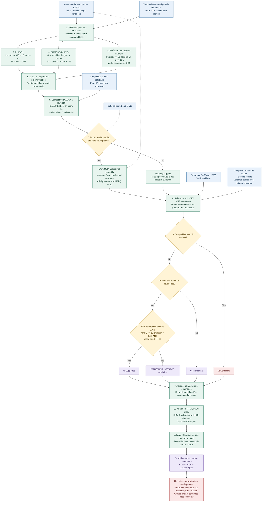

# plant-virus-screen

[中文版](README.zh-CN.md)

An assembly-based workflow for discovering virus-related sequences in plant transcriptomes and producing auditable evidence reports. Development version 0.1.0 combines enhanced discovery with legacy ICTV VMR annotation, reference-related summaries, and alignment plots.

This workflow identifies **candidates**, not confirmed infections or species. It accepts an existing assembly; read cleaning and assembly are upstream tasks. Reads are optional for discovery but required for mapping-supported grade A. Searches are not restricted to plant viruses: sequences from associated organisms may also be detected.

## Workflow overview

The diagram shows data dependencies and the default evidence-grading rules. See [the standalone diagram](docs/workflow.md) for interpretation notes and an editable Mermaid source.



## Contents

- [Requirements and databases](#requirements-and-databases)
- [Quick start](#quick-start)
- [Workflow, step by step](#workflow-step-by-step)
- [Evidence grades](#evidence-grades)
- [Options](#options)
- [Output files](#output-files)
- [Reproducibility, validation and limitations](#reproducibility-validation-and-limitations)

## Requirements and databases

### Software

Use a Unix-like shell with Bash and Python 3. Install the Python dependency in your own environment:

```bash
python3 -m pip install -r requirements.txt
```

`requirements.txt` currently specifies `biopython>=1.85`. Fresh discovery requires BLASTN, DIAMOND and HMMER (`hmmsearch`); read mapping also requires BWA and samtools. HTML/SVG plotting does not require LibreOffice; optional PDF export requires `soffice` or `libreoffice` and has not been validated end to end.

The discovery engine still defaults to development-machine executable paths. On another machine, explicitly set **absolute executable paths**, for example:

```bash
export PYTHON_BIN=/absolute/path/to/env/bin/python
export BLASTN_BIN=/absolute/path/to/blastn
export DIAMOND_BIN=/absolute/path/to/diamond
export HMMSEARCH_BIN=/absolute/path/to/hmmsearch
export BWA_BIN=/absolute/path/to/bwa
export SAMTOOLS_BIN=/absolute/path/to/samtools
```

Replace these placeholders with installed tools. Bare command names are not sufficient for discovery preflight because executable checks use file paths. `PYTHON_BIN` selects the interpreter used by the shell entry point. Reporting existing results does not invoke the discovery tools.

### Data resources

| Resource | Argument | Purpose |
|---|---|---|
| Assembly FASTA | `--query` | Unique contig IDs; full assembly, not only preselected viral contigs |
| Viral nucleotide BLAST database prefix | `--nt-db` | BLASTN discovery; provide the prefix, not a single index filename |
| Viral protein DIAMOND database | `--viral-db` | Translated similarity discovery |
| Competitive DIAMOND database | `--competitive-db` | Compare candidates against viral and cellular proteins |
| Matching competitive protein FASTA | `--competitive-fasta` | Retrieve subject annotations; plain or gzipped FASTA |
| Subject taxonomy TSV | `--taxonomy-map` | Classify competitive subjects using exact IDs and lineage tokens |
| Pfam-A HMM file | `--pfam` | Extract RNA polymerase-related profiles |
| Viral nucleotide FASTA | `--nt-fasta` | Reference labels for reporting; plain FASTA |
| Viral protein FASTA | `--protein-fasta` | Reference labels and protein plots; plain FASTA |
| ICTV VMR workbook | `--vmr` | Reference-derived genome and host annotations |
| Paired-end reads | `--reads1`, `--reads2` | Optional mapping against the full assembly |

Build BLAST and DIAMOND databases with the corresponding tools before running. Keep each database and its source FASTA consistent, including full subject IDs. Large sequence databases, Pfam, reads, assemblies and sample results are not bundled.

### Included ICTV VMR workbook

The repository includes [`data/VMR_MSL41.v1.20260320.xlsx`](data/VMR_MSL41.v1.20260320.xlsx), copied without modification from the user-provided local workbook. Attribution: International Committee on Taxonomy of Viruses (ICTV), Virus Metadata Resource (VMR). This is a pinned local copy, not a claim that the latest release has been retrieved. Its upstream download URL and redistribution terms have not been independently verified here; consult ICTV for current releases and applicable terms. No repository license is asserted over this third-party workbook.

- Required worksheet: `VMR MSL41`
- Parsed data rows: 19,271
- Size: 3,839,416 bytes
- SHA-256: `9d51698034d0bf54648de94b3ff6bf99fc1d9d2b116681991f6284901dd8b4a2`
- Copy provenance: [`data/VMR provenance.json`](data/VMR%20provenance.json)

Always pass `--vmr`; the bundled file is not automatically selected. A replacement workbook must match the sheet/schema expected by `legacy/select_final_candidates.py`.

### Competitive taxonomy format

Use a tab-separated table with unique, nonempty `subject_id` and a `lineage` column. IDs must match the competitive DIAMOND subjects exactly. Example (illustrative IDs):

```tsv
subject_id	lineage
viral_reference_1	Viruses;Riboviria
cellular_reference_1	Eukaryota;Viridiplantae
```

Classification uses exact semicolon-delimited tokens: `Viruses` gives `viral`; `Bacteria`, `Archaea` or `Eukaryota` gives `cellular`; missing, mixed or unsupported lineage assignments remain `unclassified`. Optional columns include taxid, scientific name and mapping provenance. If a sidecar `<map.tsv>.json` exists, the engine checks its FASTA/map hashes and optional database hash. Without a map, competitive hits remain unclassified and cannot satisfy grade A. The historical default auto-map is not distributed (`taxonomy_data/` is ignored); provide your own map explicitly.

## Quick start

Clone the repository and run from its root:

```bash
git clone https://github.com/changQing111/plant-virus-screen.git
cd plant-virus-screen
```

All `/path/to/...` values below are placeholders. Output directories must not already exist. Configure executable paths as described above.

### Full discovery with paired reads

```bash
bash screen_virus_res.sh \
  --query /path/to/assembly.fasta \
  --reads1 /path/to/clean_R1.fastq.gz \
  --reads2 /path/to/clean_R2.fastq.gz \
  --nt-db /path/to/viral_nt_db \
  --viral-db /path/to/viral_protein.dmnd \
  --competitive-db /path/to/competitive.dmnd \
  --competitive-fasta /path/to/competitive.fasta.gz \
  --taxonomy-map /path/to/competitive_taxonomy.tsv \
  --pfam /path/to/Pfam-A.hmm \
  --vmr data/VMR_MSL41.v1.20260320.xlsx \
  --nt-fasta /path/to/viral_nt.fasta \
  --protein-fasta /path/to/viral_protein.fasta \
  --threads 8 --plots supported --out sample_virus_res
```

To check discovery prerequisites without running searches, append `--preflight` to that command. Preflight is not an end-to-end validation and does not verify scientific database suitability.

### Assembly only

Use the same command but remove both reads arguments and add `--no-mapping`. This records mapping as not requested; it does not treat absent mapping evidence as a negative test. BWA/samtools checks are skipped in this mode. Grade A cannot be reached without qualifying coverage evidence.

### Re-report an existing enhanced result

```bash
bash screen_virus_res.sh \
  --existing-results /path/to/sample_enhanced_res \
  --vmr data/VMR_MSL41.v1.20260320.xlsx \
  --nt-fasta /path/to/viral_nt.fasta \
  --protein-fasta /path/to/viral_protein.fasta \
  --plots supported --out sample_report_res
```

This runs annotation, grading, summaries and plotting only. Do not add discovery options such as `--query`, `--threads` or `--no-mapping` to `--existing-results`. The source manifest must say `completed`; required files are listed below. Existing source outputs are not modified.

## Workflow, step by step

### 1. Validate inputs and initialize provenance

`screen_virus_res.sh` launches `unified_pipeline.py`, which validates the three reporting resources and coverage thresholds. Fresh discovery delegates to `enhanced_v1/pipeline.py`. The engine checks required paths/tools, positive thread count, paired reads or explicit mapping omission, and taxonomy provenance where supplied. It rejects empty assemblies and duplicate contig IDs. IDs are the first whitespace-delimited FASTA header token. The full assembly establishes the candidate audit universe.

The wrapper creates `run_manifest.json`; discovery creates `manifest.json` and records executed command arrays plus `commands.log`. Existing output directories are refused. Preflight does not execute sequence searches.

### 2. Nucleotide homology search

BLASTN uses `-task blastn`, search E-value `1e-5`, and 17 columns. A hit contributes `nt` evidence only if aligned length is at least **300 nt**, E-value at most **1e-10**, and bit score at least **200**. These are local alignment criteria, not whole-genome coverage or species demarcation thresholds. No additional percent-identity cutoff is applied.

Column order in `blastn.tsv`:

```text
qseqid sseqid qlen slen pident length qcovs qcovhsp qcovus mismatch gapopen qstart qend sstart send evalue bitscore
```

### 3. Translated protein homology search

DIAMOND BLASTX searches the viral protein database using `--very-sensitive`, E-value `1e-5`, and up to 25 targets. A hit contributes `protein` evidence when aligned length is at least **100 aa**, E-value at most **1e-5**, and bit score at least **80**.

Column order in `blastx.tsv`:

```text
qseqid sseqid qlen slen pident length qcovhsp mismatch gapopen qstart qend sstart send evalue bitscore
```

Discovery accepts paired `--blastn` and `--blastx` tables in these exact formats, checks query IDs/lengths against the assembly, and bypasses these two searches. **Current integration caveat:** reused tables are not copied into `discovery/`, whereas reporting expects them there. This is not yet a seamless end-to-end reuse mode; prefer fresh discovery or `--existing-results` with a complete source directory. The viral database path is still checked even when tables are supplied.

### 4. Six-frame translation and RdRp-domain discovery

All assembly sequences, not just homology candidates, are translated in six frames. Stop-delimited peptide fragments of at least **80 aa** are written to `orfs.faa`; contig, strand, frame and nucleotide coordinates are recorded in `orf_coordinates.tsv`. This is not a dedicated gene caller and does not require a start codon.

Profiles are extracted from Pfam NAME/DESC text using the keywords `rdrp`, `rna-dependent rna polymerase`, `rna dependent rna polymerase`, or `rna replicase`. The selected HMM file and model list are retained. This is keyword-based selection, not an independently curated comprehensive viral marker panel.

HMMER searches use sequence/domain reporting thresholds `1e-3`. Retained domains require independent domain E-value ≤ **1e-5** and aligned model coverage ≥ **0.25**, calculated as `(hmm_end - hmm_start + 1) / model_length`. Passing hits contribute `RdRP_domain`. The marker set primarily targets RNA-virus polymerases and does not comprehensively cover DNA viruses or reverse-transcribing viruses.

### 5. Merge candidate evidence

The candidate set is the **union** of passing `nt`, `protein` and `RdRP_domain` evidence. Any one category is sufficient for retention. Candidates and IDs are exported; every original contig remains represented in `all_contigs_audit.tsv`. Evidence categories are not statistically independent and should not be interpreted as independent diagnostic tests.

### 6. Competitive protein comparison

Candidate nucleotide sequences undergo DIAMOND BLASTX against the competitive database (`--very-sensitive`, E-value `1e-5`, up to 50 targets). Hits receive taxonomy labels from the supplied exact-ID mapping. The highest-bit-score hit determines `competitive_best_class`; ties retain the first encountered hit.

This version does not compare viral/cellular score margins or resolve competing alignment regions. Database composition can affect the result. Cellular-best candidates are flagged, not discarded; no-hit and unclassified results are retained.

### 7. Optional read mapping and coverage

BWA indexes a copy of the **full assembly** and maps paired reads with BWA-MEM. samtools sorts/indexes the BAM, runs `quickcheck` and `flagstat`, and measures depth over candidate contigs. The full assembly gives related noncandidate transcripts a chance to compete for reads; it is not a substitute for a host-reference analysis.

Two coverage tables are produced: all accepted alignments (`-Q 0`) and MAPQ≥20 (`-Q 20`). Each contains mean depth, fraction of contig bases with depth≥1, and fraction with depth≥5. The denominator is full contig length. Only MAPQ≥20 breadth at 1× and mean depth enter grade A. Library duplicates, contamination, strand support and local coverage discontinuities are not automatically resolved. Mapping is skipped if there are no candidates or `--no-mapping` is requested.

### 8. Attach reference and ICTV annotations

Reporting selects the highest-bit-score qualifying nucleotide/protein hit and retrieves descriptions from the supplied reference FASTAs. Legacy logic infers a reference-related virus name and segment/protein description. Unknown groups are assigned contig-specific labels rather than being collapsed into one virus.

The VMR mapper uses accession, normalized name and fallback genus/species-related mappings to attach genome composition, Baltimore group and reference host fields. Mapping may fail or be ambiguous. It does **not** establish a definitive ICTV species assignment. `host_status` remains `undetermined`; `host_source` describes the reference virus, not the sampled organism's infection status. A missing plant-host match is reported as `plant_host_not_documented_by_this_mapping`, not proof that the candidate cannot infect plants. Some legacy output labels and the generated `REPORT.md` remain Chinese.

### 9. Grade and summarize evidence

Each candidate receives the grade and reason below. All candidates, including conflicts, remain in `annotated_candidates.tsv`. Summaries group by inferred reference-related names and retain contig IDs and grade counts. Multiple contigs may represent one viral genome or segment; a group count is **not** an established virus species count. Automated assembly merging, complete-genome reconstruction and formal species demarcation are not implemented.

### 10. Plot and validate outputs

`--plots supported` plots grades A/B; `all` includes all grades; `none` skips plotting. Legacy modules produce nucleotide-reference and protein alignment HTML/SVG figures for applicable hits. A domain-only candidate may have no homolog alignment plot. `--pdf` requests LibreOffice conversion and may fail if the converter is unavailable. Plot selection changes visualization only, not the retained candidate table.

Reporting verifies unique candidate IDs, agreement with retained audit IDs, coverage IDs when available, candidate order/count preservation, group count totals, and presence of HTML when applicable plotting was requested. `validation.json` records required source-file hashes, VMR hash, thresholds and grading version. Wrapper failures are recorded as `failed` with an error; a populated directory alone is not evidence of successful completion.

## Evidence grades

Rules are evaluated in this order; D overrides other support.

| Grade | Implemented rule | Meaning |
|---|---|---|
| `D_conflicting` | Competitive best class is `cellular` | Source conflict requiring review |
| `A_supported` | At least two categories among nt/protein/RdRP_domain, viral competitive best hit, MAPQ≥20 breadth≥0.8 and mean depth≥5 | Highest review priority under the heuristic |
| `B_supported` | At least two evidence categories but not A or D | Multiple evidence categories, incomplete validation |
| `C_provisional` | Remaining candidates | Single-category or unresolved support |

`--mapping-breadth` and `--mapping-depth` change the A-grade coverage requirements. There is no validated diagnostic probability attached to any grade. Grade D does not prove absence of a virus; grade A does not prove plant infection, a complete genome, a new virus or a taxonomic species.

## Options

| Reporting option | Default / role |
|---|---|
| `--out` | Required, new output directory |
| `--vmr`, `--nt-fasta`, `--protein-fasta` | All required, even with no plots |
| `--existing-results` | Completed enhanced source directory; skip discovery |
| `--plots` | `supported`; choices `all`, `supported`, `none` |
| `--pdf` | Off; request optional PDF conversion |
| `--mapping-breadth` | 0.8, range 0–1 |
| `--mapping-depth` | 5.0, nonnegative |

Fresh-discovery options are forwarded to the enhanced engine: `--query`, `--reads1`, `--reads2`, `--threads` (8), `--nt-db`, `--viral-db`, `--competitive-db`, `--competitive-fasta`, `--taxonomy-map`, `--pfam`, `--no-mapping`, `--preflight`, and paired `--blastn`/`--blastx` (caveat above). Explicitly supply database paths on new machines. The compatibility flag `--enhanced` is accepted but is unnecessary; there are no implemented `--profile full` or `--config` options.

```bash
bash screen_virus_res.sh --help
"${PYTHON_BIN:-python3}" enhanced_v1/pipeline.py --help
```

## Output files

```text
sample_virus_res/
├── run_manifest.json
├── discovery/                     # Fresh discovery only
│   ├── manifest.json / commands.log
│   ├── blastn.tsv / blastx.tsv
│   ├── rdrp.hmm / selected_models.txt
│   ├── orfs.faa / orf_coordinates.tsv / domains.domtbl
│   ├── domain_evidence.tsv
│   ├── candidates.fasta / candidate_ids.txt
│   ├── competitive.tsv / competitive_annotated.tsv
│   ├── all_contigs_audit.tsv / final_candidates.tsv
│   ├── mapping_reference.fasta / mapping.bam / mapping.bam.bai
│   ├── mapping.flagstat.txt / candidates.bed
│   └── depth_{all,mapq20}.tsv / coverage_{all,mapq20}.tsv
└── report/
    ├── annotated_candidates.tsv
    ├── virus_evidence_summary.tsv
    ├── virus_summary_legacy.tsv
    ├── plot_candidates.tsv
    ├── nt_plots/ / protein_plots/
    ├── nt_plots.log / protein_plots.log
    ├── validation.json
    └── REPORT.md
```

Mapping files exist only when mapping runs. Plot directories/logs depend on selected candidates. BWA index files are also retained; temporary mapping SAM is removed.

For `--existing-results`, the required source files are `final_candidates.tsv`, `all_contigs_audit.tsv`, `blastn.tsv`, `blastx.tsv`, `competitive_annotated.tsv`, `domain_evidence.tsv` and `manifest.json`. `coverage_mapq20.tsv` is optional, but qualifying mapping evidence is needed for grade A. Do not mix files from different assemblies or runs.

Start interpretation with `annotated_candidates.tsv` (evidence, grade, reason, coverage, reference/VMR fields), then `virus_evidence_summary.tsv`. Confirm `run_manifest.json` says `completed` and `report/validation.json` says `passed`. These checks establish internal consistency, not biological truth.

## Reproducibility, validation and limitations

Run lightweight checks from the repository root:

```bash
bash -n screen_virus_res.sh
"${PYTHON_BIN:-python3}" -m unittest test_grading.py
```

Earlier development validation covered complete LGTZ/HZS candidate post-processing and HTML/SVG generation. It did not rerun upstream searches. Fresh assembly-to-report end-to-end execution, cross-machine portability and PDF export are not yet fully validated. This documentation/VMR update does not constitute a new full scientific regression run.

Record assembly/read provenance, library preparation, tool versions and database releases for each study. Manifests record command arguments and selected hashes, but do not yet inventory every executable version and every discovery database hash. Existing-result mode does not comprehensively revalidate scientific equivalence of its resources.

Main interpretation limits: transcriptome assemblies may be fragmented, redundant or chimeric; poly(A) selection and other library biases alter sensitivity; viral-like sequences can originate from associated organisms, endogenous elements or contamination. Competition is best-hit based, HMM models are keyword selected, and grading is heuristic. Species or novel-virus claims need taxon-appropriate comparative analysis; infection claims may require independent experimental support. A negative result means no passing evidence under the current data, databases and rules.

Common failures: an existing `--out` requires choosing a new directory; missing tools require explicit executable paths; absent references require matching FASTAs/database files; missing taxonomy prevents viral/cellular resolution; unsupported VMR sheets require a schema-compatible workbook; PDF failure can be avoided by omitting `--pdf`. Keep failed run logs for diagnosis rather than interpreting partial output as a completed report.
