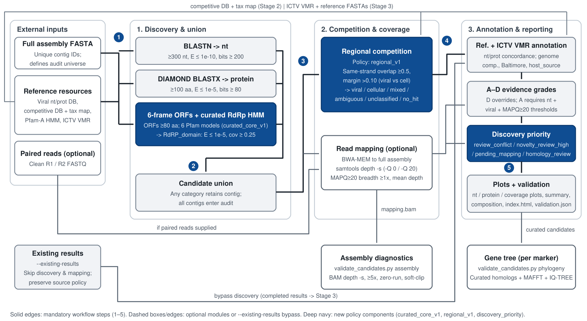

# plant-virus-screen

[English](README.md)

基于已组装转录组的植物样本病毒相关序列发现与证据报告流程。当前流程包含 RdRp 白名单、区域竞争、独立的新病毒复核优先级、ICTV VMR 注释及证据绘图，并提供可选拼接诊断与基因树分析。

策略标识分别为 `evidence_policy_version=1.0.0`、`hmm_policy=curated_core_v1`、`competition_method=regional_v1`，报告分级版本为 `0.3.0-separate-discovery-priority`；这些是不同策略的标识，不代表发布了新的软件包版本。

本流程输出**候选序列与复核优先级**，不能直接确诊感染或确定物种。输入为已有组装；原始 reads 质控和转录组组装属于上游步骤。搜索范围不限制为已知植物病毒，也可能检出伴生生物相关病毒。只有组装也能发现候选，但缺少合格回贴证据时不能获得 A 级。

## 流程图



*矢量源文件：[SVG](docs/workflow_figure.svg) · [PDF](docs/workflow_figure.pdf)。* 图内使用英文，具体阈值与分级规则见下文。参见[独立流程图及解释说明](docs/workflow.md)（内含文字版 Mermaid 源码）。D 级冲突优先判定；所有候选均保留。缺少回贴证据不等于阴性，分级也不等于确诊感染。

## 1. 软件与数据准备

使用 Unix 类环境、Bash 和 Python 3。在自己的 Python 环境中安装依赖：

```bash
python3 -m pip install -r requirements.txt
```

目前 Python 依赖为 `biopython>=1.85`。新发现流程需要 BLASTN、DIAMOND、HMMER 的 `hmmsearch`；回贴还需要 BWA 和 samtools（支持 `depth -s`）；可选基因树分析需要 MAFFT 和 IQ-TREE。绘图不依赖 LibreOffice：图形为自包含 HTML（内嵌 SVG），PDF 由公共渲染层（`legacy/render_common.py`）原生输出矢量 PDF，无需外部转换器。

增强内核仍保留开发主机默认工具路径。换机器时需指定实际安装位置，例如：

```bash
export PYTHON_BIN=/absolute/path/to/env/bin/python
export BLASTN_BIN=/absolute/path/to/blastn
export DIAMOND_BIN=/absolute/path/to/diamond
export HMMSEARCH_BIN=/absolute/path/to/hmmsearch
export BWA_BIN=/absolute/path/to/bwa
export SAMTOOLS_BIN=/absolute/path/to/samtools
```

这些均为占位路径。发现阶段按文件路径检查可执行权限，因此仅写 `diamond` 等命令名不足以通过检查。`PYTHON_BIN` 决定入口解释器。仅处理已有结果时不会调用发现阶段工具。

| 输入资源 | 参数 | 用途 |
|---|---|---|
| 完整组装 FASTA | `--query` | 每条序列 ID 唯一，不应只输入预筛候选 |
| 病毒核酸 BLAST 库前缀 | `--nt-db` | 核酸同源搜索，传数据库前缀而非索引文件 |
| 病毒蛋白 DIAMOND 库 | `--viral-db` | 翻译同源搜索 |
| 竞争蛋白 DIAMOND 库 | `--competitive-db` | 包含病毒与细胞来源蛋白 |
| 与竞争库匹配的 FASTA | `--competitive-fasta` | 提取描述，支持普通或 gzip FASTA |
| 竞争命中分类映射 | `--taxonomy-map` | TSV，按精确 subject ID 对应分类谱系 |
| Pfam-A HMM | `--pfam` | 提取白名单中的六个病毒 RdRp 模型 |
| 病毒核酸 FASTA | `--nt-fasta` | 后处理参考描述，需普通文本 FASTA |
| 病毒蛋白 FASTA | `--protein-fasta` | 后处理描述和蛋白绘图，需普通文本 FASTA |
| ICTV VMR 工作簿 | `--vmr` | 参考病毒的基因组与宿主注释 |
| 成对原始或清洁 reads | `--reads1`, `--reads2` | 可选完整组装回贴 |

运行前用相应工具建立 BLAST/DIAMOND 库，确保数据库和来源 FASTA 的版本及完整 subject ID 一致。仓库不附带大型序列库、Pfam、reads、组装和样本结果。

### 随仓库附带的 VMR 表

[`data/VMR_MSL41.v1.20260320.xlsx`](data/VMR_MSL41.v1.20260320.xlsx) 从用户提供的本地原文件完整复制，未修改。来源署名为 International Committee on Taxonomy of Viruses（ICTV）的 Virus Metadata Resource（VMR）。这是固定版本的本地副本，不表示已下载最新版本。本次未独立核实上游下载地址和再分发条款；最新版本及适用条款应查询 ICTV，仓库不为该第三方表格另行授予许可。

- 工作表：`VMR MSL41`
- 解析数据行：19,271
- 文件大小：3,839,416 字节
- SHA-256：`9d51698034d0bf54648de94b3ff6bf99fc1d9d2b116681991f6284901dd8b4a2`
- 副本溯源：[data/VMR provenance.json](data/VMR%20provenance.json)

运行时仍须显式指定 `--vmr`，程序不会自动选用仓库副本。更换版本时需符合 `legacy/select_final_candidates.py` 预期的工作表和字段结构。

### 分类映射格式

TSV 必须包含 `subject_id` 和 `lineage`，ID 非空且唯一，并与竞争数据库命中 ID 完全一致。示例 ID 仅作说明：

```tsv
subject_id	lineage
viral_reference_1	Viruses;Riboviria
cellular_reference_1	Eukaryota;Viridiplantae
```

按分号拆分后精确识别分类词：含 `Viruses` 为病毒；含 `Bacteria`、`Archaea` 或 `Eukaryota` 为细胞来源；缺失、冲突或不支持的标签为未分类。可附 taxid、学名及来源等字段。若存在 `<map.tsv>.json`，程序检查其中 FASTA、映射表以及可选数据库哈希。没有映射表时竞争命中保持未分类，不能满足 A 级。历史默认映射目录 `taxonomy_data/` 未发布，请显式提供映射表。

## 2. 运行示例

```bash
git clone https://github.com/changQing111/plant-virus-screen.git
cd plant-virus-screen
```

下面 `/path/to/...` 都需替换为实际路径。输出目录必须尚不存在；先按前述说明配置工具路径。

### 新组装加双端 reads

```bash
bash screen_virus_res.sh \
  --query /path/to/assembly.fasta \
  --reads1 /path/to/clean_R1.fastq.gz \
  --reads2 /path/to/clean_R2.fastq.gz \
  --nt-db /path/to/viral_nt_db \
  --viral-db /path/to/viral_protein.dmnd \
  --competitive-db /path/to/competitive.dmnd \
  --competitive-fasta /path/to/competitive.fasta.gz \
  --taxonomy-map /path/to/competitive_taxonomy.tsv \
  --pfam /path/to/Pfam-A.hmm \
  --vmr data/VMR_MSL41.v1.20260320.xlsx \
  --nt-fasta /path/to/viral_nt.fasta \
  --protein-fasta /path/to/viral_protein.fasta \
  --threads 8 --plots supported --out sample_virus_res
```

在上述命令末尾添加 `--preflight` 可仅检查发现阶段前置条件，不执行搜索。预检查不能代替端到端运行，也不验证数据库的科学适用性。

### 只有组装

使用相同命令，移除两个 reads 参数，添加 `--no-mapping`。此时回贴状态记录为未请求，缺少回贴不等于阴性。BWA/samtools 检查会跳过；没有合格覆盖证据不能获得 A 级。

### 已有增强结果重新生成报告

```bash
bash screen_virus_res.sh \
  --existing-results /path/to/sample_enhanced_res \
  --vmr data/VMR_MSL41.v1.20260320.xlsx \
  --nt-fasta /path/to/viral_nt.fasta \
  --protein-fasta /path/to/viral_protein.fasta \
  --plots supported --out sample_report_res
```

该方式只做注释、分级、汇总和绘图，不修改原结果。不能同时传入 `--query`、`--threads`、`--no-mapping` 等发现阶段参数。来源目录的 manifest 必须为 `completed`，完整文件要求见后文。

## 3. 逐步方法说明

### 步骤 1：输入检查与运行记录

`screen_virus_res.sh` 启动 `unified_pipeline.py`，检查 VMR、两个参考 FASTA 和覆盖阈值。新分析调用 `enhanced_v1/pipeline.py`，检查文件、工具、线程数、成对 reads 或显式跳过回贴，以及已提供的分类映射溯源。空组装和重复 ID 会报错；FASTA ID 为标题第一个空白前的字段。完整组装定义全量审计范围。

入口写入 `run_manifest.json`，发现阶段写入 `manifest.json`、实际命令数组及 `commands.log`。不覆盖已有输出目录。

### 步骤 2：核酸同源搜索

BLASTN 使用 `-task blastn`，搜索 E-value 为 `1e-5`。只有比对长度至少 **300 nt**、E-value 不大于 **1e-10**、bit score 至少 **200** 的命中才提供 `nt` 证据。这里是局部比对阈值，不是全基因组覆盖或物种划分标准；没有额外的一致性百分比阈值。

`blastn.tsv` 的 17 列顺序：

```text
qseqid sseqid qlen slen pident length qcovs qcovhsp qcovus mismatch gapopen qstart qend sstart send evalue bitscore
```

### 步骤 3：蛋白同源搜索

DIAMOND BLASTX 对病毒蛋白库使用 `--very-sensitive`、E-value `1e-5`、最多 25 个目标。比对长度至少 **100 aa**、E-value 不大于 **1e-5**、bit score 至少 **80** 时提供 `protein` 证据。

`blastx.tsv` 的 15 列顺序：

```text
qseqid sseqid qlen slen pident length qcovhsp mismatch gapopen qstart qend sstart send evalue bitscore
```

发现内核接受同时提供 `--blastn` 和 `--blastx`，格式须与上述列顺序一致，检查 query ID 和长度后复制到 `discovery/blastn.tsv` 和 `discovery/blastx.tsv`，仅跳过这两项搜索。HMM、竞争检索及可选回贴仍会执行；除跳过的 BLASTN 可执行文件外，其他相关数据库和工具路径仍会检查。复用表必须来自相同组装及预期参考库，仅 ID/长度一致不能证明数据等价。

### 步骤 4：六框翻译与 RdRp 结构域搜索

对全部组装序列做正反链六框翻译，以终止密码子分隔，保留至少 **80 aa** 的片段。`orfs.faa` 保存肽段，`orf_coordinates.tsv` 保存 contig、链、框和核酸坐标。该方法不要求起始密码子，也不是专用基因预测器。

通过 `enhanced_v1/evidence_policy.py` 按 **Pfam 稳定 accession 与模型名称同时匹配**，不再按描述关键词选模型。保留 HMM 和实际选中的模型列表，manifest 记录白名单及策略版本。当前保守面板为：

| Pfam accession（忽略版本后缀） | 必须匹配的模型名称 |
|---|---|
| PF00680 | RdRP_1 |
| PF00978 | RdRP_2 |
| PF00998 | RdRP_3 |
| PF02123 | RdRP_4 |
| PF07925 | RdRP_5 |
| PF05919 | Mitovir_RNA_pol |

排除细胞来源 RDR6 模型（`RBD_RDR6`、`RDR6_2nd`）及聚合酶相关辅助结构域（`PH_fung_RdRP`、`PH_met_RdRP`）。六模型面板并不完整，可能漏掉其他病毒聚合酶家族。目前代码仅在一个模型都未找到时报错，不强制六个全部存在；解释阴性结果前须检查 `selected_models.txt` 与 manifest。

HMMER 序列和结构域报告阈值为 `1e-3`；最终结构域要求独立 E-value≤**1e-5**，模型覆盖比例≥**0.25**，覆盖公式为 `(hmm_end-hmm_start+1)/model_length`。合格命中提供 `RdRP_domain` 证据。该模型集主要针对 RNA 病毒聚合酶，不能全面覆盖 DNA 病毒或逆转录病毒。

### 步骤 5：合并候选

取 `nt`、`protein`、`RdRP_domain` 的**并集**，任一类别通过即可保留。导出候选 FASTA 和 ID；所有原始 contig 都写入 `all_contigs_audit.tsv`。三类证据并不统计独立，不能按独立诊断试验理解。

### 步骤 6：竞争蛋白比对

对候选核酸序列进行 DIAMOND BLASTX 竞争检索，使用 `--very-sensitive`、E-value `1e-5`、最多 50 个目标。按精确 ID 映射分类；逐条命中的分类仍为 `viral`、`cellular` 或 `unclassified`。

新运行按局部 query 区间比较：

1. 仅比较同链、不同来源分类的命中，交集长度除以较长区间长度须≥0.5，即两个区间均至少有 50% 被覆盖。
2. 为每条病毒/细胞命中选择满足重叠要求的最高分异类命中，计算 `(自身分数−竞争分数)/max(两者分数,1)`。差值>0.10 支持自身，绝对差值≤0.10 为 `ambiguous`，否则为 `outscored`；不累计多个 HSP 的分数。
3. contig 汇总优先级：同时有保留的病毒与细胞状态→`mixed`；否则有歧义→`ambiguous`；否则有未分类状态→`unclassified`；否则使用剩余病毒/细胞状态；没有竞争命中→`no_hit`。因此未分类命中会保守地阻止形成纯病毒/细胞汇总。

`competitive_regions.tsv` 保存区间分数和判定。兼容字段仍称 `competitive_best_class`，但新运行中表示区域汇总，并可取 `mixed`/`ambiguous`。目前按区间而非 ORF 比较，不能据此确诊嵌合；阈值未标定，数据库覆盖与 50 个目标限制仍影响结果。所有候选均保留。

旧结果若未声明 `competition_method=regional_v1`，报告继续使用原最高分规则校验。重新生成报告不会重新搜索或移除旧 HMM 命中；采用新策略须重跑发现阶段。

### 步骤 7：可选 reads 回贴与覆盖

复制**完整组装**建立 BWA 索引，使用 BWA-MEM 回贴双端 reads。samtools 排序、索引、执行 `quickcheck` 和 `flagstat`，再统计候选区域深度。完整组装使非候选同源转录本参与竞争，但不等同于宿主参考基因组分析。

新运行使用 `samtools depth -s` 抑制重叠双端 reads 的重复计数。分别统计所有接受的比对（`-Q 0`）及 MAPQ≥20（`-Q 20`）。指标包括平均深度、深度≥1 的覆盖广度、深度≥5 的覆盖广度，分母均为完整 contig 长度。A 级仅使用 MAPQ≥20 的 1× 广度和平均深度。程序不会自动解决重复分子、污染、链支持和局部覆盖断裂问题。没有候选或指定 `--no-mapping` 时跳过回贴。

### 步骤 8：参考标签与 ICTV 注释

后处理选择通过阈值且 bit score 最高的核酸/蛋白命中，从参考 FASTA 提取描述，沿用传统规则推断参考相关名称及片段/蛋白描述。无法命名的候选附带各自 contig ID，避免被误合并为同一种病毒。`putative_segment_or_protein` 现在按实际存在的证据标注：仅核酸命中与仅 RdRp 结构域命中不再被写成蛋白支持候选。新增 `nt_reference_name`、`protein_reference_name`、`reference_name_concordance` 和 `putative_virus_scope` 字段记录核酸与蛋白参考名称是否一致；不一致只是复核提示，不是分类结论，也不会剔除候选。

VMR 注释按 accession、标准化名称及属/物种相关回退映射补充基因组组成、Baltimore 分组和参考宿主信息。accession 映射仅从最佳核酸命中中提取完整的 INSDC/RefSeq 核酸 accession，并保留稳定顺序；不会从 UniProt ID、蛋白描述或推断名称中截取数字片段。命中描述还会保守地去除 `, complete genome`、`, complete cds`、`isolate X`、`strain X`、`segment N`、`(strain X)` 等修饰语还原为裸病毒名称；原始描述优先，清洗后的名称只有在 VMR 中解析出唯一值时才采用。双义 `ssDNA(+/-)` 现在映射为 Baltimore II 组。映射可能缺失或歧义，不能直接当作确定的 ICTV 物种归属。`host_status` 保持 `undetermined`；`host_source` 描述参考病毒，不证明当前植物感染。没有映射到植物宿主会标记 `plant_host_not_documented_by_this_mapping`，不代表排除植物感染。部分传统字段标签和自动 `REPORT.md` 仍为中文。

### 步骤 9：统一分级与病毒相关汇总

按下表分级并记录原因，同时记录独立的 `discovery_priority`。旧字段 `priority=primary/secondary` 仍仅由 A/B 分级决定，新病毒复核应使用 `discovery_priority`。全部候选保存在 `annotated_candidates.tsv`。按推断参考相关名称汇总，保留 contig ID 和等级计数。一个病毒或片段可以有多个 contig，因此**分组数不是已确认的病毒物种数**。当前不自动合并组装、重建完整基因组或执行正式物种划分。

### 步骤 10：绘图与一致性验证

`--plots supported` 选择 A/B 级以及 `novelty_review_high` / `novelty_review_pending_mapping` 候选，`all` 包含所有等级，`none` 不绘图。对适用同源命中生成符合出版级规范（`nature-figure` 风格）的核酸参考（`nt_plots/`）和蛋白比对图形（`protein_plots/`），每张为自包含 HTML（含悬停提示）加单页原生矢量 PDF，统一经公共渲染层（`legacy/render_common.py`）输出。比对图采用纯白无外框画布、色盲安全且灰度单调递减的冰青—深海蓝顺序色阶（`#9CCAD6` -> `#42949E` -> `#3775BA` -> `#0F4D92`）、图内完整标题与统计摘要、粗体小写面板标签（`a`、`b`）、参考与序列坐标刻度尺、自动换行的左侧独立 contig 信息栏，以及基于真实字宽的多道（multi-lane）HSP 区间与坐标排布，避免标签与线段碰撞。当来源结果含 `depth_mapq20.tsv` 时，还会为每个绘制的候选 contig 绘制 MAPQ>=20 覆盖深度曲线（`coverage_plots/`，均值虚线、P99 截顶纵轴；覆盖绘图批处理脚本默认最多处理 200 个 contig，被跳过的仍记录在其 manifest；`--max-contigs` 不是统一入口参数）。若某 contig 没有深度明细行、但覆盖汇总明确记录平均深度 0.0 与广度 0.0，则绘制全零曲线并在 manifest 标记 `ok_zero_depth`，不再静默跳过；真正缺失覆盖数据仍标记 `skipped_no_depth`。与绘图选择无关，报告始终生成报告级汇总仪表盘（`report_summary.html` + PDF）：证据分级分布（对数轴）、按分级构成堆叠的参考相关分组 Top 排名、以及 A/B/C 候选的覆盖总览散点图（平均深度 × ≥1x 广度，标注报告回贴阈值线），图底部附中英双语分级与阈值术语表（PDF 中文经开源字体子集——默认文泉驿微米黑，可用环境变量 PVS_CJK_FONT 覆盖——直接嵌入每个 PDF，任何阅读器都能正确显示；无字体环境回退为非嵌入 Type0 引用）。同时生成配套的分类组成图（`composition_summary.html` + PDF）：A/B/C 候选按 VMR 宿主来源、基因组组成 / Baltimore 分组和本流程植物病毒状态分类的堆叠条形图，并附 VMR 注释范围免责声明。报告根目录同时生成 `index.html` 图形索引，列出全部图形及链接。仅结构域命中可能没有同源比对图。`--pdf` 控制是否写出 PDF 文件（不依赖外部转换器）。绘图选择不改变候选保留范围。

校验涵盖候选 ID 唯一性、审计保留 ID 一致性、可用覆盖表 ID、输出顺序与数量、分组计数总和，以及应绘图时 HTML 是否产生。报告还会从原始 BLAST 表和 `domain_evidence.tsv` 重新计算每条 contig 的证据并与 audit/候选表核对，再从 `competitive_annotated.tsv` 按来源 manifest 的策略重算竞争汇总；混用或过期的发现文件会失败。`validation.json` 记录这些语义检查、必需来源文件哈希、VMR 哈希、阈值和分级版本。失败会写入 `failed` 和错误信息；目录有文件不代表运行完成。

## 4. 证据等级

按以下顺序判断，D 级优先于其他支持。

| 等级 | 实际规则 | 含义 |
|---|---|---|
| `D_conflicting` | 竞争汇总为 `cellular` | 来源冲突，需复核 |
| `A_supported` | 至少两类证据**且必须包含 `nt`**，竞争汇总为 `viral`，MAPQ≥20 广度≥0.8 且平均深度≥5 | 具有回贴支持的多证据类别 |
| `B_supported` | 至少两类证据，但不满足 A 或 D | 多类证据，验证不完整或缺少独立核酸命中 |
| `C_provisional` | 其他候选 | 单类或未解决证据 |

`--mapping-breadth` 和 `--mapping-depth` 可调整 A 级覆盖要求。DIAMOND BLASTX 与 RdRp HMM 通常命中同一聚合酶区域，因此不含 `nt` 的 `protein;RdRP_domain` 组合现在保留为 B 级，不再视为两类独立确认。等级不是经过标定的诊断概率。D 不证明没有病毒，A 不证明植物感染、完整基因组、新病毒或具体物种。

## 新病毒复核优先级

A–D 分级继续保留。独立字段 `discovery_priority` 按以下顺序判定：

| 取值 | 实际规则 |
|---|---|
| `review_conflict` | 竞争汇总为 `mixed`、`ambiguous` 或 `cellular`，优先于其他支持 |
| `novelty_review_high` | 来源 manifest 声明 `curated_core_v1`，存在 `RdRP_domain`，无上述冲突，MAPQ20 广度与平均深度达到报告阈值 |
| `novelty_review_pending_mapping` | 同样满足白名单 RdRp 条件，但覆盖未达到阈值或缺少覆盖表 |
| `homology_review` | 其余候选，包括旧运行的结构域证据 |

进入新病毒复核不要求 nt 命中。竞争为 `no_hit` 或 `unclassified` 也可能进入该队列，来源不确定性仍未解决。存在 nt 命中的候选也可标为 `novelty_review_high`；此字段不是序列新颖度测量，应结合 `discovery_priority_reason`、等级和区间证据复核。兼容分级不会把 `mixed`/`ambiguous` 自动设为 D，须用 `review_conflict` 找到这些候选。

报告当前固定写入 `novelty_status=not_assessed_requires_reference_comparison_and_phylogeny` 和 `assembly_validation_status=not_assessed`。独立后续分析不会自动回写这些字段或提升分级。

## 拼接诊断与系统发育分析

从仓库目录使用合适的 Python 环境运行，输出目录必须尚不存在。大型分析须在调度资源内执行。

### 拼接诊断

```bash
"${PYTHON_BIN:-python3}" validate_candidates.py assembly \
  --discovery /path/to/sample_virus_res/discovery \
  --samtools /absolute/path/to/samtools \
  --out /path/to/sample_virus_res/assembly_validation
```

需要 `final_candidates.tsv` 和 `mapping.bam`。重新统计 MAPQ20 深度并使用 `-s`，输出平均深度、≥1×/≥5×广度、最长零覆盖区间、正常配对比例，以及含至少 10 nt 软剪切的主要 MAPQ20 比对比例。若 ≥5×广度<0.8、最长零覆盖区间≥100 nt 或软剪切比例>0.1，则标为 `review`，否则为 `coverage_screen_passed`。正常配对比例仅报告，不参与该判定。这些阈值固定在辅助脚本内，与可配置的 A 级阈值独立。

输出包括 `assembly_validation.tsv`、`depth.tsv`、`candidates.bed` 和 `manifest.json`。通过检查不能证明连接点正确或排除嵌合；当前没有连接点跨越验证，也不自动纠正序列。

### 按同源标记构建基因树

将下方占位路径替换为本机安装的 MAFFT 与 IQ-TREE 2/3 可执行文件路径：

```bash
export MAFFT_BIN=/absolute/path/to/mafft
export IQTREE_BIN=/absolute/path/to/iqtree3
"$IQTREE_BIN" --version

"${PYTHON_BIN:-python3}" validate_candidates.py phylogeny \
  --proteins /absolute/path/to/curated_RdRp.faa \
  --candidate-ids /absolute/path/to/candidate_protein_ids.txt \
  --marker RdRp --mafft "$MAFFT_BIN" --iqtree "$IQTREE_BIN" \
  --threads 4 --occupancy 0.5 --out /path/to/new_RdRp_tree
```

人工整理同源蛋白或同源结构域区域：至少 4 条非空、不含终止字符且 FASTA ID 唯一的序列，同时包含候选和参考。`candidate_protein_ids.txt` 是空白分隔的**蛋白 FASTA ID**；只有在 ID 相同的情况下才可使用 contig ID。所有指定候选必须存在于 FASTA，并至少保留一条参考。不同病毒家族/非同源标记不能混建一棵树。脚本可检查格式，但不能判断同源性、参考适用性或分类覆盖是否充分。

脚本执行 MAFFT `--auto`，保留非 `-`、`X`、`?` 字符占比达到 `--occupancy` 的列（默认 0.5；修剪后至少 80 列），随后执行 IQ-TREE `-st AA -m MFP -B 1000 --alrt 1000 -seed 42`。输出 `aligned.faa`、`trimmed.faa`、`tree.treefile`、`tree.iqtree`、日志和 completed/failed `manifest.json`。结果是无根基因树；定根、参考选择、类群特异物种划分和宿主确认须另行完成。

辅助脚本 `--iqtree` 默认值为 `iqtree2`，若使用 IQ-TREE 3 请如上显式传入 `iqtree3` 绝对路径。辅助脚本只读取命令行工具参数，不直接读取 `MAFFT_BIN`/`IQTREE_BIN` 环境变量。

## 5. 参数汇总

| 报告参数 | 默认值/作用 |
|---|---|
| `--out` | 必填，新目录 |
| `--vmr`, `--nt-fasta`, `--protein-fasta` | 均必填，即使不绘图 |
| `--existing-results` | 使用完成的增强结果，跳过发现 |
| `--plots` | 默认 `supported`；可选 `all`、`supported`、`none` |
| `--pdf` | 默认关闭 |
| `--mapping-breadth` | 0.8，范围 0–1 |
| `--mapping-depth` | 5.0，非负 |

新发现参数转交增强内核：`--query`、`--reads1`、`--reads2`、`--threads`（默认 8）、`--nt-db`、`--viral-db`、`--competitive-db`、`--competitive-fasta`、`--taxonomy-map`、`--pfam`、`--no-mapping`、`--preflight` 及成对 `--blastn`/`--blastx`（见复用说明）。新机器上显式提供数据库路径。兼容参数 `--enhanced` 可以省略；尚未实现 `--profile full` 或 `--config`。

```bash
bash screen_virus_res.sh --help
"${PYTHON_BIN:-python3}" enhanced_v1/pipeline.py --help
```

## 6. 输出文件

```text
sample_virus_res/
├── run_manifest.json
├── discovery/                     # 仅新发现模式
│   ├── manifest.json / commands.log
│   ├── blastn.tsv / blastx.tsv
│   ├── rdrp.hmm / selected_models.txt
│   ├── orfs.faa / orf_coordinates.tsv / domains.domtbl
│   ├── domain_evidence.tsv
│   ├── candidates.fasta / candidate_ids.txt
│   ├── competitive.tsv / competitive_annotated.tsv / competitive_regions.tsv
│   ├── all_contigs_audit.tsv / final_candidates.tsv
│   ├── mapping_reference.fasta / mapping.bam / mapping.bam.bai
│   ├── mapping.flagstat.txt / candidates.bed
│   └── depth_{all,mapq20}.tsv / coverage_{all,mapq20}.tsv
└── report/
    ├── annotated_candidates.tsv
    ├── virus_evidence_summary.tsv
    ├── virus_summary_legacy.tsv
    ├── plot_candidates.tsv
    ├── index.html
    ├── report_summary.html / report_summary.pdf
    ├── composition_summary.html / composition_summary.pdf
    ├── nt_plots/ / protein_plots/ / coverage_plots/
    ├── nt_plots.log / protein_plots.log / coverage_plots.log
    ├── validation.json
    └── REPORT.md
```

回贴文件仅在实际执行时产生；绘图目录/日志取决于所选候选。BWA 索引会保留，临时 SAM 会删除。

已有结果模式要求来源目录包含 `final_candidates.tsv`、`all_contigs_audit.tsv`、`blastn.tsv`、`blastx.tsv`、`competitive_annotated.tsv`、`domain_evidence.tsv`、`manifest.json`。`coverage_mapq20.tsv` 可缺省，但 A 级需要合格回贴数据。不得混用不同组装或运行的文件。

建议先读 `annotated_candidates.tsv` 的证据、等级、原因、覆盖及注释，再读 `virus_evidence_summary.tsv`。确认入口 manifest 为 `completed` 且 `report/validation.json` 为 `passed`。内部一致性通过不代表生物学结论已验证。

## 7. 验证范围、复现与常见问题

仓库根目录可运行：

```bash
bash -n screen_virus_res.sh
"${PYTHON_BIN:-python3}" -m unittest discover -v
```

截至 2026-11-16：57 项单元测试全部通过（含 `test_grading.py`、`test_evidence_policy.py`、`test_summary_layout.py`、`test_alignment_plots_layout.py`），重绘的 `nt_plots/` 与 `protein_plots/` 原生矢量 PDF 及 `docs/workflow_figure.svg`/`.pdf` 均通过 `nature-figure` 字号（>=5 pt）与零碰撞检测。候选基因树需针对具体标记人工整理同源序列集合后构建。

研究中应额外保存组装/reads 来源、建库方式、软件版本和数据库版本。manifest 已记录命令参数及部分哈希，但尚未完整记录所有工具版本和全部发现数据库哈希；已有结果模式也不全面核验各参考资源的科学等价性。

组装可能碎片化、冗余或嵌合；poly(A) 富集等建库偏倚影响检出；病毒样序列可能来自伴生生物、内源元件或污染。区域竞争、六模型 HMM 面板和优先级均为启发式规则，面板不完整，分级不是经过标定的概率。物种和新病毒认定需对应类群的比较分析，感染判断可能需独立实验支持。未检出只表示当前数据、数据库和规则下没有通过证据。

常见问题：输出目录已存在时选新目录；工具不存在时配置绝对路径；参考缺失时补齐匹配的 FASTA/数据库；没有分类映射时无法可靠区分病毒与细胞；VMR 工作表不匹配时使用兼容版本；PDF 失败可省略 `--pdf`。保留失败日志用于定位，不将部分结果当作完成报告。
