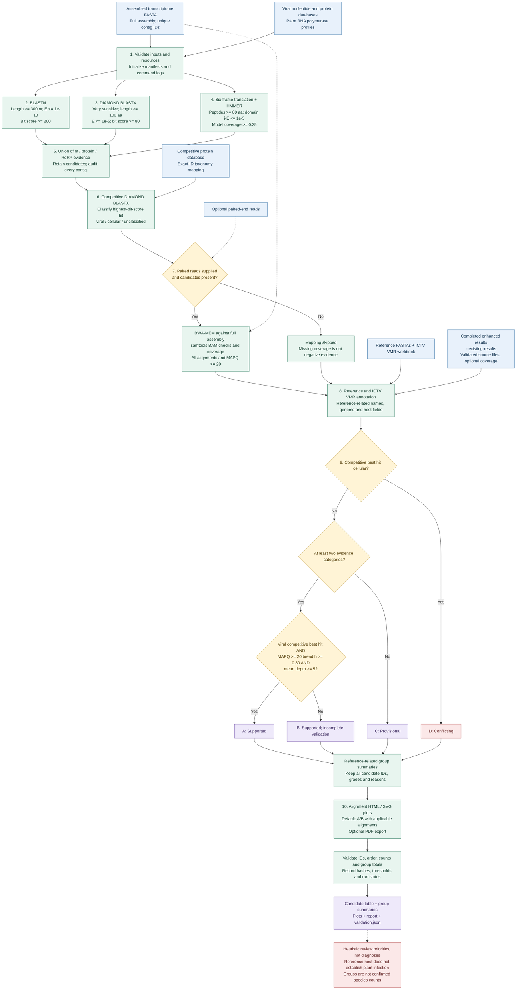

# plant-virus-screen

[English](README.md)

基于已组装转录组的植物样本病毒相关序列发现与证据报告流程。开发版 0.1.0 以增强模式为主干，接入传统 ICTV VMR 注释、参考相关分组汇总和比对绘图。

本流程输出**候选序列与复核优先级**，不能直接确诊感染或确定物种。输入为已有组装；原始 reads 质控和转录组组装属于上游步骤。搜索范围不限制为已知植物病毒，也可能检出伴生生物相关病毒。只有组装也能发现候选，但缺少合格回贴证据时不能获得 A 级。

## 流程图

下图展示数据依赖和默认的证据分级规则，图内使用英文。箭头不表示实际并行执行。参见[独立流程图及可编辑 Mermaid 源码](docs/workflow.md)。D 级冲突优先判定；所有候选均保留。缺少回贴证据不等于阴性，分级也不等于确诊感染。



## 1. 软件与数据准备

使用 Unix 类环境、Bash 和 Python 3。在自己的 Python 环境中安装依赖：

```bash
python3 -m pip install -r requirements.txt
```

目前 Python 依赖为 `biopython>=1.85`。新发现流程需要 BLASTN、DIAMOND、HMMER 的 `hmmsearch`；回贴还需要 BWA 和 samtools。HTML/SVG 绘图不要求 LibreOffice；可选 PDF 导出需要 `soffice` 或 `libreoffice`，尚未完成端到端验证。

增强内核仍保留开发主机默认工具路径。换机器时需指定实际安装位置，例如：

```bash
export PYTHON_BIN=/absolute/path/to/env/bin/python
export BLASTN_BIN=/absolute/path/to/blastn
export DIAMOND_BIN=/absolute/path/to/diamond
export HMMSEARCH_BIN=/absolute/path/to/hmmsearch
export BWA_BIN=/absolute/path/to/bwa
export SAMTOOLS_BIN=/absolute/path/to/samtools
```

这些均为占位路径。发现阶段按文件路径检查可执行权限，因此仅写 `diamond` 等命令名不足以通过检查。`PYTHON_BIN` 决定入口解释器。仅处理已有结果时不会调用发现阶段工具。

| 输入资源 | 参数 | 用途 |
|---|---|---|
| 完整组装 FASTA | `--query` | 每条序列 ID 唯一，不应只输入预筛候选 |
| 病毒核酸 BLAST 库前缀 | `--nt-db` | 核酸同源搜索，传数据库前缀而非索引文件 |
| 病毒蛋白 DIAMOND 库 | `--viral-db` | 翻译同源搜索 |
| 竞争蛋白 DIAMOND 库 | `--competitive-db` | 包含病毒与细胞来源蛋白 |
| 与竞争库匹配的 FASTA | `--competitive-fasta` | 提取描述，支持普通或 gzip FASTA |
| 竞争命中分类映射 | `--taxonomy-map` | TSV，按精确 subject ID 对应分类谱系 |
| Pfam-A HMM | `--pfam` | 提取 RNA 聚合酶相关模型 |
| 病毒核酸 FASTA | `--nt-fasta` | 后处理参考描述，需普通文本 FASTA |
| 病毒蛋白 FASTA | `--protein-fasta` | 后处理描述和蛋白绘图，需普通文本 FASTA |
| ICTV VMR 工作簿 | `--vmr` | 参考病毒的基因组与宿主注释 |
| 成对原始或清洁 reads | `--reads1`, `--reads2` | 可选完整组装回贴 |

运行前用相应工具建立 BLAST/DIAMOND 库，确保数据库和来源 FASTA 的版本及完整 subject ID 一致。仓库不附带大型序列库、Pfam、reads、组装和样本结果。

### 随仓库附带的 VMR 表

[`data/VMR_MSL41.v1.20260320.xlsx`](data/VMR_MSL41.v1.20260320.xlsx) 从用户提供的本地原文件完整复制，未修改。来源署名为 International Committee on Taxonomy of Viruses（ICTV）的 Virus Metadata Resource（VMR）。这是固定版本的本地副本，不表示已下载最新版本。本次未独立核实上游下载地址和再分发条款；最新版本及适用条款应查询 ICTV，仓库不为该第三方表格另行授予许可。

- 工作表：`VMR MSL41`
- 解析数据行：19,271
- 文件大小：3,839,416 字节
- SHA-256：`9d51698034d0bf54648de94b3ff6bf99fc1d9d2b116681991f6284901dd8b4a2`
- 副本溯源：[data/VMR provenance.json](data/VMR%20provenance.json)

运行时仍须显式指定 `--vmr`，程序不会自动选用仓库副本。更换版本时需符合 `legacy/select_final_candidates.py` 预期的工作表和字段结构。

### 分类映射格式

TSV 必须包含 `subject_id` 和 `lineage`，ID 非空且唯一，并与竞争数据库命中 ID 完全一致。示例 ID 仅作说明：

```tsv
subject_id	lineage
viral_reference_1	Viruses;Riboviria
cellular_reference_1	Eukaryota;Viridiplantae
```

按分号拆分后精确识别分类词：含 `Viruses` 为病毒；含 `Bacteria`、`Archaea` 或 `Eukaryota` 为细胞来源；缺失、冲突或不支持的标签为未分类。可附 taxid、学名及来源等字段。若存在 `<map.tsv>.json`，程序检查其中 FASTA、映射表以及可选数据库哈希。没有映射表时竞争命中保持未分类，不能满足 A 级。历史默认映射目录 `taxonomy_data/` 未发布，请显式提供映射表。

## 2. 运行示例

```bash
git clone https://github.com/changQing111/plant-virus-screen.git
cd plant-virus-screen
```

下面 `/path/to/...` 都需替换为实际路径。输出目录必须尚不存在；先按前述说明配置工具路径。

### 新组装加双端 reads

```bash
bash screen_virus_res.sh \
  --query /path/to/assembly.fasta \
  --reads1 /path/to/clean_R1.fastq.gz \
  --reads2 /path/to/clean_R2.fastq.gz \
  --nt-db /path/to/viral_nt_db \
  --viral-db /path/to/viral_protein.dmnd \
  --competitive-db /path/to/competitive.dmnd \
  --competitive-fasta /path/to/competitive.fasta.gz \
  --taxonomy-map /path/to/competitive_taxonomy.tsv \
  --pfam /path/to/Pfam-A.hmm \
  --vmr data/VMR_MSL41.v1.20260320.xlsx \
  --nt-fasta /path/to/viral_nt.fasta \
  --protein-fasta /path/to/viral_protein.fasta \
  --threads 8 --plots supported --out sample_virus_res
```

在上述命令末尾添加 `--preflight` 可仅检查发现阶段前置条件，不执行搜索。预检查不能代替端到端运行，也不验证数据库的科学适用性。

### 只有组装

使用相同命令，移除两个 reads 参数，添加 `--no-mapping`。此时回贴状态记录为未请求，缺少回贴不等于阴性。BWA/samtools 检查会跳过；没有合格覆盖证据不能获得 A 级。

### 已有增强结果重新生成报告

```bash
bash screen_virus_res.sh \
  --existing-results /path/to/sample_enhanced_res \
  --vmr data/VMR_MSL41.v1.20260320.xlsx \
  --nt-fasta /path/to/viral_nt.fasta \
  --protein-fasta /path/to/viral_protein.fasta \
  --plots supported --out sample_report_res
```

该方式只做注释、分级、汇总和绘图，不修改原结果。不能同时传入 `--query`、`--threads`、`--no-mapping` 等发现阶段参数。来源目录的 manifest 必须为 `completed`，完整文件要求见后文。

## 3. 逐步方法说明

### 步骤 1：输入检查与运行记录

`screen_virus_res.sh` 启动 `unified_pipeline.py`，检查 VMR、两个参考 FASTA 和覆盖阈值。新分析调用 `enhanced_v1/pipeline.py`，检查文件、工具、线程数、成对 reads 或显式跳过回贴，以及已提供的分类映射溯源。空组装和重复 ID 会报错；FASTA ID 为标题第一个空白前的字段。完整组装定义全量审计范围。

入口写入 `run_manifest.json`，发现阶段写入 `manifest.json`、实际命令数组及 `commands.log`。不覆盖已有输出目录。

### 步骤 2：核酸同源搜索

BLASTN 使用 `-task blastn`，搜索 E-value 为 `1e-5`。只有比对长度至少 **300 nt**、E-value 不大于 **1e-10**、bit score 至少 **200** 的命中才提供 `nt` 证据。这里是局部比对阈值，不是全基因组覆盖或物种划分标准；没有额外的一致性百分比阈值。

`blastn.tsv` 的 17 列顺序：

```text
qseqid sseqid qlen slen pident length qcovs qcovhsp qcovus mismatch gapopen qstart qend sstart send evalue bitscore
```

### 步骤 3：蛋白同源搜索

DIAMOND BLASTX 对病毒蛋白库使用 `--very-sensitive`、E-value `1e-5`、最多 25 个目标。比对长度至少 **100 aa**、E-value 不大于 **1e-5**、bit score 至少 **80** 时提供 `protein` 证据。

`blastx.tsv` 的 15 列顺序：

```text
qseqid sseqid qlen slen pident length qcovhsp mismatch gapopen qstart qend sstart send evalue bitscore
```

发现内核接受同时提供 `--blastn` 和 `--blastx`，格式必须完全一致，并检查 query ID 和长度。但**当前整合存在限制**：复用表不会复制到 `discovery/`，而后处理要求该目录内有这些表，因此该接口尚不是无缝完整复用方案。优先重新发现，或对文件完整的既有结果使用 `--existing-results`。即使复用表，病毒蛋白数据库路径仍会被检查。

### 步骤 4：六框翻译与 RdRp 结构域搜索

对全部组装序列做正反链六框翻译，以终止密码子分隔，保留至少 **80 aa** 的片段。`orfs.faa` 保存肽段，`orf_coordinates.tsv` 保存 contig、链、框和核酸坐标。该方法不要求起始密码子，也不是专用基因预测器。

从 Pfam 模型 NAME/DESC 中按 `rdrp`、`rna-dependent rna polymerase`、`rna dependent rna polymerase`、`rna replicase` 关键词筛选模型，保留 HMM 和模型列表。这是关键词筛选，并非经过独立人工审定的完整病毒标记集。

HMMER 序列和结构域报告阈值为 `1e-3`；最终结构域要求独立 E-value≤**1e-5**，模型覆盖比例≥**0.25**，覆盖公式为 `(hmm_end-hmm_start+1)/model_length`。合格命中提供 `RdRP_domain` 证据。该模型集主要针对 RNA 病毒聚合酶，不能全面覆盖 DNA 病毒或逆转录病毒。

### 步骤 5：合并候选

取 `nt`、`protein`、`RdRP_domain` 的**并集**，任一类别通过即可保留。导出候选 FASTA 和 ID；所有原始 contig 都写入 `all_contigs_audit.tsv`。三类证据并不统计独立，不能按独立诊断试验理解。

### 步骤 6：竞争蛋白比对

对候选核酸序列进行 DIAMOND BLASTX 竞争检索，使用 `--very-sensitive`、E-value `1e-5`、最多 50 个目标。按精确 ID 映射分类，最高 bit score 命中决定 `competitive_best_class`；同分时保留先出现的命中。

当前没有实现病毒与细胞命中的分差判定或区域级比较，结果受数据库构成影响。细胞最佳命中只标记冲突，不删除候选；无命中和未分类也保留。

### 步骤 7：可选 reads 回贴与覆盖

复制**完整组装**建立 BWA 索引，使用 BWA-MEM 回贴双端 reads。samtools 排序、索引、执行 `quickcheck` 和 `flagstat`，再统计候选区域深度。完整组装使非候选同源转录本参与竞争，但不等同于宿主参考基因组分析。

分别统计所有接受的比对（`-Q 0`）及 MAPQ≥20（`-Q 20`）。指标包括平均深度、深度≥1 的覆盖广度、深度≥5 的覆盖广度，分母均为完整 contig 长度。A 级仅使用 MAPQ≥20 的 1× 广度和平均深度。程序不会自动解决重复分子、污染、链支持和局部覆盖断裂问题。没有候选或指定 `--no-mapping` 时跳过回贴。

### 步骤 8：参考标签与 ICTV 注释

后处理选择通过阈值且 bit score 最高的核酸/蛋白命中，从参考 FASTA 提取描述，沿用传统规则推断参考相关名称及片段/蛋白描述。无法命名的候选附带各自 contig ID，避免被误合并为同一种病毒。

VMR 注释按 accession、标准化名称及属/物种相关回退映射补充基因组组成、Baltimore 分组和参考宿主信息。映射可能缺失或歧义，不能直接当作确定的 ICTV 物种归属。`host_status` 保持 `undetermined`；`host_source` 描述参考病毒，不证明当前植物感染。没有映射到植物宿主会标记 `plant_host_not_documented_by_this_mapping`，不代表排除植物感染。部分传统字段标签和自动 `REPORT.md` 仍为中文。

### 步骤 9：统一分级与病毒相关汇总

按下表分级并记录原因，全部候选保存在 `annotated_candidates.tsv`。按推断参考相关名称汇总，保留 contig ID 和等级计数。一个病毒或片段可以有多个 contig，因此**分组数不是已确认的病毒物种数**。当前不自动合并组装、重建完整基因组或执行正式物种划分。

### 步骤 10：绘图与一致性验证

`--plots supported` 绘制 A/B 级，`all` 包含所有等级，`none` 不绘图。对适用同源命中生成核酸参考和蛋白比对 HTML/SVG；仅结构域命中可能没有同源比对图。`--pdf` 调用 LibreOffice，可因转换器缺失而失败。绘图选择不改变候选保留范围。

校验涵盖候选 ID 唯一性、审计保留 ID 一致性、可用覆盖表 ID、输出顺序与数量、分组计数总和，以及应绘图时 HTML 是否产生。`validation.json` 记录必需来源文件哈希、VMR 哈希、阈值和分级版本。失败会写入 `failed` 和错误信息；目录有文件不代表运行完成。

## 4. 证据等级

按以下顺序判断，D 级优先于其他支持。

| 等级 | 实际规则 | 含义 |
|---|---|---|
| `D_conflicting` | 竞争最佳命中为细胞来源 | 来源冲突，需复核 |
| `A_supported` | 至少两类证据，竞争最佳为病毒，MAPQ≥20 广度≥0.8 且平均深度≥5 | 当前启发式规则下优先复核 |
| `B_supported` | 至少两类证据，但不满足 A 或 D | 多类证据，验证不完整 |
| `C_provisional` | 其他候选 | 单类或未解决证据 |

`--mapping-breadth` 和 `--mapping-depth` 可调整 A 级覆盖要求。等级不是经过标定的诊断概率。D 不证明没有病毒，A 不证明植物感染、完整基因组、新病毒或具体物种。

## 5. 参数汇总

| 报告参数 | 默认值/作用 |
|---|---|
| `--out` | 必填，新目录 |
| `--vmr`, `--nt-fasta`, `--protein-fasta` | 均必填，即使不绘图 |
| `--existing-results` | 使用完成的增强结果，跳过发现 |
| `--plots` | 默认 `supported`；可选 `all`、`supported`、`none` |
| `--pdf` | 默认关闭 |
| `--mapping-breadth` | 0.8，范围 0–1 |
| `--mapping-depth` | 5.0，非负 |

新发现参数转交增强内核：`--query`、`--reads1`、`--reads2`、`--threads`（默认 8）、`--nt-db`、`--viral-db`、`--competitive-db`、`--competitive-fasta`、`--taxonomy-map`、`--pfam`、`--no-mapping`、`--preflight` 及成对 `--blastn`/`--blastx`（见前述限制）。新机器上显式提供数据库路径。兼容参数 `--enhanced` 可以省略；尚未实现 `--profile full` 或 `--config`。

```bash
bash screen_virus_res.sh --help
"${PYTHON_BIN:-python3}" enhanced_v1/pipeline.py --help
```

## 6. 输出文件

```text
sample_virus_res/
├── run_manifest.json
├── discovery/                     # 仅新发现模式
│   ├── manifest.json / commands.log
│   ├── blastn.tsv / blastx.tsv
│   ├── rdrp.hmm / selected_models.txt
│   ├── orfs.faa / orf_coordinates.tsv / domains.domtbl
│   ├── domain_evidence.tsv
│   ├── candidates.fasta / candidate_ids.txt
│   ├── competitive.tsv / competitive_annotated.tsv
│   ├── all_contigs_audit.tsv / final_candidates.tsv
│   ├── mapping_reference.fasta / mapping.bam / mapping.bam.bai
│   ├── mapping.flagstat.txt / candidates.bed
│   └── depth_{all,mapq20}.tsv / coverage_{all,mapq20}.tsv
└── report/
    ├── annotated_candidates.tsv
    ├── virus_evidence_summary.tsv
    ├── virus_summary_legacy.tsv
    ├── plot_candidates.tsv
    ├── nt_plots/ / protein_plots/
    ├── nt_plots.log / protein_plots.log
    ├── validation.json
    └── REPORT.md
```

回贴文件仅在实际执行时产生；绘图目录/日志取决于所选候选。BWA 索引会保留，临时 SAM 会删除。

已有结果模式要求来源目录包含 `final_candidates.tsv`、`all_contigs_audit.tsv`、`blastn.tsv`、`blastx.tsv`、`competitive_annotated.tsv`、`domain_evidence.tsv`、`manifest.json`。`coverage_mapq20.tsv` 可缺省，但 A 级需要合格回贴数据。不得混用不同组装或运行的文件。

建议先读 `annotated_candidates.tsv` 的证据、等级、原因、覆盖及注释，再读 `virus_evidence_summary.tsv`。确认入口 manifest 为 `completed` 且 `report/validation.json` 为 `passed`。内部一致性通过不代表生物学结论已验证。

## 7. 验证范围、复现与常见问题

仓库根目录可运行：

```bash
bash -n screen_virus_res.sh
"${PYTHON_BIN:-python3}" -m unittest test_grading.py
```

此前开发验证覆盖 LGTZ/HZS 完整候选后处理和 HTML/SVG 生成，没有重新执行上游搜索。新组装到报告的端到端执行、跨机器可移植性和 PDF 尚未完全验证。本次文档和 VMR 更新不代表重新完成了整套科研回归。

研究中应额外保存组装/reads 来源、建库方式、软件版本和数据库版本。manifest 已记录命令参数及部分哈希，但尚未完整记录所有工具版本和全部发现数据库哈希；已有结果模式也不全面核验各参考资源的科学等价性。

组装可能碎片化、冗余或嵌合；poly(A) 富集等建库偏倚影响检出；病毒样序列可能来自伴生生物、内源元件或污染。竞争目前仅按最佳命中，HMM 采用关键词选择，分级是启发式方法。物种和新病毒认定需对应类群的比较分析，感染判断可能需独立实验支持。未检出只表示当前数据、数据库和规则下没有通过证据。

常见问题：输出目录已存在时选新目录；工具不存在时配置绝对路径；参考缺失时补齐匹配的 FASTA/数据库；没有分类映射时无法可靠区分病毒与细胞；VMR 工作表不匹配时使用兼容版本；PDF 失败可省略 `--pdf`。保留失败日志用于定位，不将部分结果当作完成报告。
