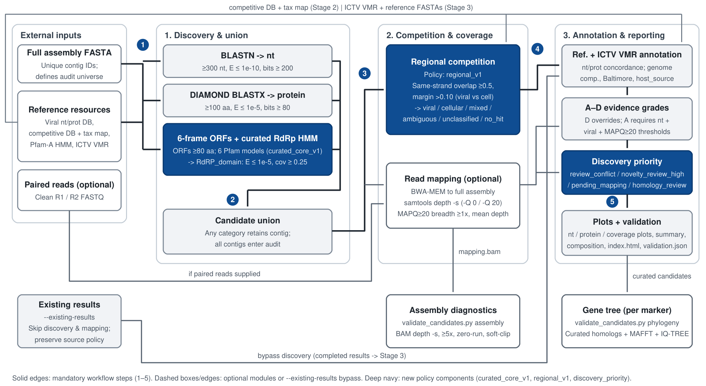
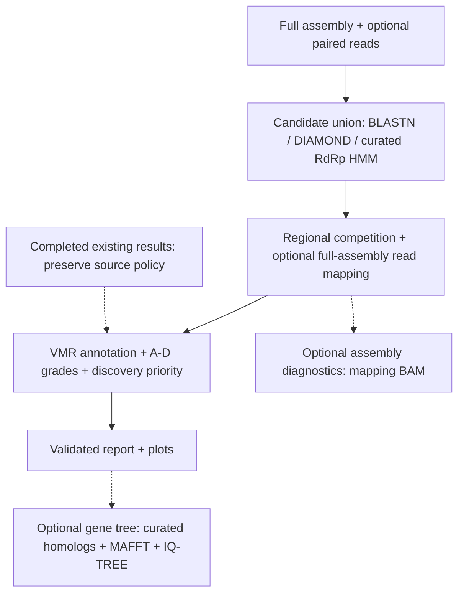

# Workflow diagram

Editable vector files: [workflow_figure.svg](workflow_figure.svg) · [workflow_figure.pdf](workflow_figure.pdf).

Read cleaning, transcriptome assembly and representative clustering occur upstream.
Arrows show data dependencies, not concurrent execution. All candidates remain
retained, including source conflicts.

Fresh discovery uses accession/name-matched `curated_core_v1` HMM profiles and
same-strand interval competition (`regional_v1`), not global best-hit assignment.
The six-model panel is incomplete. See [English README](../README.md) or
[中文说明](../README.zh-CN.md) for exact models, overlap/score rules and limitations.

A–D grades and `discovery_priority` are distinct. Grade D applies to a cellular
summary; `review_conflict` additionally covers mixed/ambiguous regional evidence.
Novelty-review candidates need no nt hit, but priority does not establish novelty
or resolve unclassified competition. The evidence types are not independent.

Existing-result mode skips discovery and mapping and preserves the source
competition policy; it does not apply the new HMM panel retrospectively.
Default supported plotting includes A/B and novelty-review candidates.
Plot selection never changes candidate retention.

Assembly diagnostics and homolog-specific gene trees are optional separate
outputs, not automatic report-grade upgrades. Gene trees require manually curated
homologs and references; they do not confirm species or plant infection.
