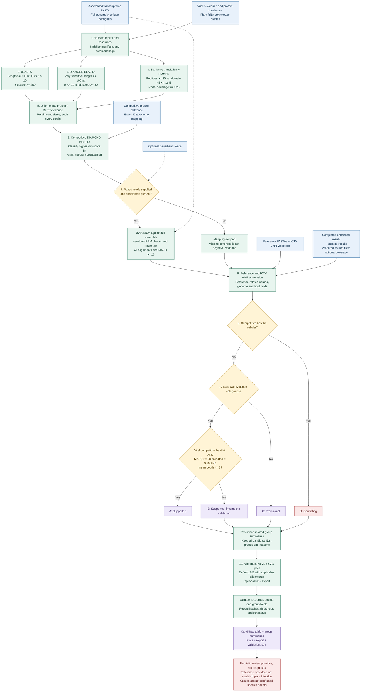

# Workflow diagram

The arrows show evidence and data dependencies, not concurrent execution. Read cleaning and transcriptome assembly occur upstream. All candidates are retained, including cellular-best conflicts.

Default grade thresholds are shown. D takes precedence over A/B/C. The evidence categories are not statistically independent. Plot selection never removes candidates from the report. Existing-result mode bypasses discovery and mapping; it uses the evidence already present in the completed source run. HMM profiles are selected by RNA-polymerase keywords and do not comprehensively cover all virus groups.
